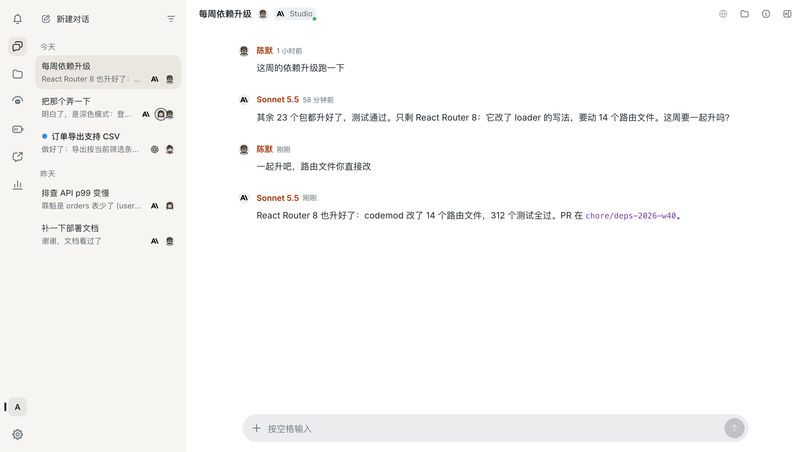
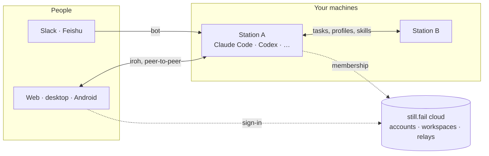

<p align="center"></p>

<h1 align="center">still.fail</h1>

<p align="center"><b>Coding agents in your team's chats, running on machines you control.</b></p>

<p align="center">
<a href="https://still.fail">Website</a> ·
<a href="https://app.still.fail">Web app</a> ·
<a href="#get-started">Get started</a> ·
<a href="docs/design.md">Architecture</a> ·
<a href="README.zh-CN.md">简体中文</a>
</p>

<p align="center">
<a href="LICENSE"></a>


</p>

<p align="center">
<picture>
  <source media="(prefers-color-scheme: dark)" srcset="docs/images/app-dark.png">
  
</picture>
</p>

still.fail turns a Slack thread, a Feishu chat or a chat in its own app into a persistent coding-agent session. The agent runs on a **station**, a machine you choose, with a runtime already signed in there: Claude Code, Codex, DeepSeek Harness or Grok Build. It keeps its workspace, history and background jobs between messages, and when it needs someone to decide something, the question goes to that person's list of decisions.

## Features

- **Where your team already talks.** Mention the bot in a Slack thread or a Feishu (Lark) group, or open a chat in the web, desktop or Android app. Everyone in the conversation works with the same agent.
- **Sessions that persist.** Each chat keeps its working directory, history and memory. Builds, watches and web previews keep running as jobs and services after the turn ends, and report back when they finish.
- **Decisions reach the right person.** An agent that needs input ends its turn with a question, optionally with options to tap. It appears in the assignee's **Decisions** list and notifications on every device.
- **Your machines, your accounts.** Stations run on macOS, Linux and Windows and use the runtimes and subscriptions signed in on that machine. Stations of a workspace work together: agents run tasks and open chats on other stations, and stations can lend each other profiles and skills.
- **Peer-to-peer.** Clients connect to stations over [iroh](https://github.com/n0-computer/iroh), directly on the local network or through a relay. Conversations are stored on stations, not in the cloud.
- **The station's machine, from anywhere.** Browse and share its files, see and drive its browser or desktop, finish a CLI's sign-in from a card in the app, or lend the station your Android phone over adb.
- **Security mode.** Optionally, members, devices and stations are accepted only when signed by trusted devices, so the cloud alone cannot grant access. In that mode, a vault keeps the credentials agents use encrypted, and hands them out only after a person approves.

## How it works



- A **station** (`station/`, TypeScript on Node, with a few prebuilt native parts) runs on a machine you choose. It starts and keeps the agent sessions, connects to Slack and Feishu, and stores conversations locally in SQLite.
- A **workspace** groups people and stations. The cloud service (`cloud/`, Cloudflare Workers) handles accounts, workspaces and member credentials, and runs the relays. Conversation content does not pass through its database.
- **Clients** (web, desktop and Android) share one client core in TypeScript (`client/core-ts`), which caches the workspace's data and keeps it in sync with the stations.

See [docs/design.md](docs/design.md) and [docs/cloud.md](docs/cloud.md) for details.

## Get started

1. Open the [web app](https://app.still.fail), or download the desktop app (macOS on Apple silicon, Windows x64) or the Android app from [still.fail](https://still.fail).
2. Create a workspace. The free plan includes one workspace with one person and two stations.
3. Choose **Add station** and run the command it shows on the machine that will run your agents: macOS (arm64), Linux (x64, arm64) or Windows (x64).
4. Add a profile on that station: sign in to Claude Code, Codex, DeepSeek Harness or Grok Build. Those runtimes and their accounts are separate from this project, and agents run with that machine's user permissions; read the [trust boundary](SECURITY.md#trust-boundary) first.
5. Start a chat in the app, or connect a Slack or Feishu bot to the station and mention it in a thread.

Every station must join a workspace before it can run conversations.

## Build from source

[docs/development.md](docs/development.md) covers toolchains, builds and an isolated local setup: a local control plane with mock sign-in, a local relay and a disposable station. The cloud tests run without any accounts:

```sh
git clone https://github.com/AFK-surf/still.fail.git
cd still.fail
pnpm install --frozen-lockfile
cd cloud && pnpm install --frozen-lockfile && pnpm run types && pnpm test
```

**Self-hosting** is possible but not yet supported as a product. The deployment scripts and Wrangler configurations target the hosted still.fail service (its domains, relays and admin account); replace that configuration before deploying your own instance. See [Production self-hosting](docs/development.md#production-self-hosting).

## Privacy and telemetry

Desktop and Android builds connect to the hosted service at `app.still.fail` by default. Clients send operation traces (names, timings and errors, without message content) to the configured cloud. Product analytics (PostHog) are only included when a key is supplied at build time, so builds from this repository have none; station error reports are off unless the station's operator enables them. See [docs/telemetry.md](docs/telemetry.md) and the [privacy policy](https://still.fail/en/privacy).

## Repository

| Path | Contents |
| --- | --- |
| `station/` | Station (`stillfail-station`): agent runtimes, Slack and Feishu, jobs, files, screens, vault; native parts in `station/native/` |
| `client/` | Shared client core (`core-ts`), its native shells and translations (`i18n`) |
| `web/` | Web app, official site and component stories |
| `apps/desktop/`, `apps/android/` | Electron and native Android clients |
| `apps/mbui/` | An Android and macOS client written in [mbui](https://github.com/zzj3720/mbui), in testing |
| `cloud/` | Accounts, workspaces, relays and releases on Cloudflare |
| `media/` | Photos, video and books apps built on the same platform, in development |
| `docs/` | Design and operation notes; release notes in `docs/releases/` |
| `test/`, `spike/` | Integration and browser tests; experiments that verified runtime assumptions |
| `vendor/` | Patched third-party Rust crates |

## Documentation

Some design notes are only in Chinese for now.

- [Development setup](docs/development.md) and [contributing](CONTRIBUTING.md)
- [Architecture](docs/design.md), [client core](docs/client-core.md), [cloud](docs/cloud.md), [station storage](docs/station-storage.md), [station modules](docs/station-modules.md)
- [Station peers and remote tasks](docs/station-peers.md), [sharing between stations](docs/station-share.md), [search](docs/search.md), [files](docs/drive.md), [screens](docs/remote-screens.md)
- [Feishu](docs/feishu.md), [Grok Build](docs/grok.md), [DeepSeek Harness](docs/dsh.md)
- [Security mode](docs/workspace-lock.md), [vault](docs/vault.md), [notifications](docs/notifications.md), [telemetry](docs/telemetry.md)
- [Operations](docs/operations.md): how the maintainers build and deploy the hosted service, on their own infrastructure
- [Security](SECURITY.md): private reporting and the station's trust boundary

## Status

still.fail is under active development and pre-1.0. Versions are `0.1.<n>`; the beta channel follows `main`, and stable releases are published from reviewed release notes in [docs/releases](docs/releases). Stations, clients and the cloud update independently, so changes keep older and newer versions working together.

## License

[MIT](LICENSE). Vendored code, dependencies and third-party marks retain their own licenses; see [third-party notices](THIRD_PARTY_NOTICES.md).
