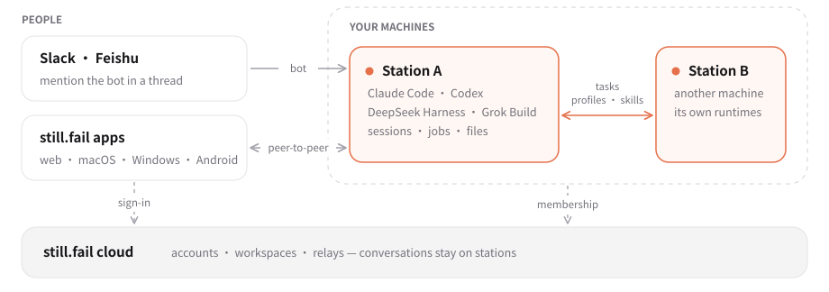

<p align="center"></p>

<h1 align="center">still.fail</h1>

<p align="center"><b>Your own machines, connected to wherever you are.</b></p>

<p align="center">
<a href="https://still.fail">Website</a> ·
<a href="https://app.still.fail">Web app</a> ·
<a href="#get-started">Get started</a> ·
<a href="README.zh-CN.md">简体中文</a>
</p>

<p align="center">
<a href="LICENSE"></a>


</p>

still.fail connects the machines you choose to wherever you are. Each runs a **station**, and you use it from the web, desktop and Android apps, a Slack thread, a Feishu chat or a Comma Task: its files, its browser and desktop, and the coding agents signed in there (Claude Code, Codex, Cursor and [others](#features)), which keep their workspace, history and background jobs between messages. A workspace's stations work as one, with their agents' accounts in one pool, and conversations stay on them: clients reach stations peer to peer.

## Features

- **Your machine, from anywhere.** Browse and share its files, see and drive its browser or desktop, finish a CLI's sign-in from a card in the app, or lend the station your Android phone over adb.
- **One account pool.** The accounts signed in on every station of a workspace are used as one: a new chat goes to a working account with the chosen model that resets soonest with the most left, and skips accounts that are signed out, refused or out of quota. When a chat has to move to another account, the agent reads its history back.
- **The agents you already use.** Claude Code, Codex, Cursor, Devin, Grok Build, DeepSeek Harness, Hermes Agent and Antigravity CLI, each with its own subscription signed in, or with an API key from a provider (OpenAI, Anthropic, Google Gemini, DeepSeek, Kimi, OpenRouter and others).
- **Machines that work as one.** Stations run on macOS, Linux and Windows and use the runtimes and subscriptions signed in on that machine. Stations of a workspace work together: agents run tasks and open chats on other stations, and stations can lend each other profiles and skills.
- **Where your team already talks.** Mention the bot in a Slack thread or a Feishu (Lark) group, bring a station's agents into a [Comma](https://comma.surf) Task, or open a chat in the app: on the web, the desktop (macOS, Windows) and Android, and through the web app on iPhone, iPad and Linux. Everyone in the conversation works with the same agent.
- **Sessions that persist.** Each chat keeps its working directory, history and memory. Builds, watches and web previews keep running as jobs and services after the turn ends, and report back when they finish.
- **Peer-to-peer.** Clients connect to stations over [iroh](https://github.com/n0-computer/iroh), directly on the local network or through a relay. Conversations are stored on stations, not in the cloud.
- **Security mode.** Optionally, members, devices and stations of a workspace are accepted only when signed by trusted devices, so the cloud alone cannot grant access. In that mode, a vault keeps the credentials agents use encrypted, and hands them out only after a person approves. Which of a person's devices are trusted is theirs alone to say, and only those can approve as them, for example lending a phone to an agent, so a stolen sign-in alone cannot.

## How it works

<picture>
  <source media="(prefers-color-scheme: dark)" srcset="docs/images/architecture-dark.svg">
  
</picture>

- A **station** (`station/`, TypeScript on Node, with a few prebuilt native parts and a reader in MoonBit) runs on a machine you choose. It starts and keeps the agent sessions, connects to Slack, Feishu and Comma, and stores conversations locally in SQLite.
- A **workspace** groups people and stations. The cloud service (`cloud/`, Cloudflare Workers) handles accounts, workspaces and member credentials, and runs the relays. Conversation content does not pass through its database.
- **Clients** are one app on every platform, written in MoonBit with the mbui UI framework (`apps/mbui/`). They share one client core in TypeScript (`client/core-ts`), which caches the workspace's data and keeps it in sync with the stations.

## Get started

1. Open the [web app](https://app.still.fail), or download the desktop app (macOS on Apple silicon, Windows x64) or the Android app from [still.fail](https://still.fail).
2. Create a workspace. The free plan includes one workspace for one person and up to 64 stations.
3. Choose **Add station** and run the command it shows on the machine that will run your agents: macOS (arm64), Linux (x64, arm64) or Windows (x64).
4. Add a profile on that station: sign in to one of the [agents above](#features), or give it a provider's API key. Those runtimes and their accounts are separate from this project, and agents run with that machine's user permissions; read the [trust boundary](SECURITY.md#trust-boundary) first.
5. Start a chat in the app, or connect a Slack or Feishu bot (or Comma) to the station and mention it in a thread.

Every station must join a workspace before it can run conversations.

## Build from source

[docs/development.md](docs/development.md) covers toolchains, builds and an isolated local setup: a local control plane with mock sign-in, a local relay and a disposable station. The cloud tests run without any accounts:

```sh
git clone https://github.com/AFK-surf/monoid.git
cd monoid
pnpm install --frozen-lockfile
cd cloud && pnpm install --frozen-lockfile && pnpm run types && pnpm test
```

**Self-hosting**: the cloud runs on workerd outside Cloudflare, with its names, relay and sign-in your own; see [cloud/selfhost](cloud/selfhost/README.md). The deployment scripts and Wrangler configurations target the hosted still.fail service (its domains, relays and admin account); see [Production self-hosting](docs/development.md#production-self-hosting).

## Privacy and telemetry

Desktop and Android builds connect to the hosted service at `app.still.fail` by default. Clients send operation traces (names, timings and errors, without message content) to the configured cloud. Product analytics (PostHog) are only included when a key is supplied at build time, so builds from this repository have none; station error reports are off unless the station's operator enables them. See the [privacy policy](https://still.fail/en/privacy).

## Repository

| Path | Contents |
| --- | --- |
| `station/` | Station (`stillfail-station`): agent runtimes, Slack and Feishu, jobs, files, screens, vault; native parts in `station/native/` |
| `client/` | Shared client core (`core-ts`), its native shell (`shell`, Rust), the browser's iroh (`iroh-wasm`) and translations (`i18n`) |
| `web/` | The web's host of the app, and its sign-in, share and admin pages |
| `website/` | The official site |
| `apps/mbui/` | The apps (Android, iOS, macOS, Windows, Linux), written in mbui (`apps/mbui/mbui`) |
| `cloud/` | Accounts, workspaces, relays and releases on Cloudflare |
| `rules/` | Rules shared by the station, the cloud and the core, in MoonBit built to JavaScript |
| `scripts/` | Checks, releases and the CI plan |
| `design/` | Brand assets and icons |
| `docs/` | Development and operation notes; release notes in `docs/releases/` |
| `test/` | Integration and browser tests |
| `vendor/` | Patched third-party Rust crates |

## Documentation

- [Development setup](docs/development.md) and [contributing](CONTRIBUTING.md)
- [Operations](docs/operations.md): how the maintainers build and deploy the hosted service, on their own infrastructure
- [Security](SECURITY.md): private reporting and the station's trust boundary
- [Linux desktop setup](docs/linux-desktop-setup.md): what a Linux station needs to share its desktop
- [LAN connections behind an outbound firewall](docs/station-lan-firewall.md): a fixed mesh port for a firewalled station

## Status

still.fail is under active development and pre-1.0. Versions are `0.1.<n>`; the beta channel follows `main`, and stable releases are published from reviewed release notes (in Chinese) in [docs/releases](docs/releases). Stations, clients and the cloud update independently, so changes keep older and newer versions working together.

## License

[MIT](LICENSE). Vendored code, dependencies and third-party marks retain their own licenses; see [third-party notices](THIRD_PARTY_NOTICES.md).
