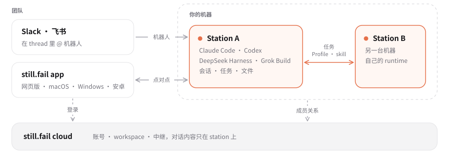

<p align="center"></p>

<h1 align="center">still.fail</h1>

<p align="center"><b>把你的机器连到任何地方</b></p>

<p align="center">
<a href="https://still.fail">官网</a> ·
<a href="https://app.still.fail">网页版</a> ·
<a href="#开始使用">开始使用</a> ·
<a href="docs/design.md">架构</a> ·
<a href="README.md">English</a>
</p>

<p align="center">
<a href="LICENSE"></a>


</p>

still.fail 把你选定的机器连到你在的任何地方。每台机器运行一个 **station**，你在网页版、桌面版、安卓 app、Slack thread 或飞书群聊里使用它：它的文件、浏览器和桌面，以及那台机器上已登录的 runtime（Claude Code、Codex、DeepSeek Harness 或 Grok Build），消息之间它们的工作目录、历史和后台任务都会保留。同一 workspace 的 station 合起来用，对话存在 station 上：客户端点对点连接 station。

## 功能

- **随时随地用你的机器。** 浏览和分享它的文件，查看并操作它的浏览器或桌面，在 app 的卡片里完成命令行工具的登录，或者通过 adb 把自己的安卓手机借给 station。
- **几台机器合起来用。** station 支持 macOS、Linux 和 Windows，使用那台机器上已登录的 runtime 和订阅。同一 workspace 的 station 互相协作：agent 可以在其他 station 上运行任务、开对话，station 之间可以借用 Profile 和 skill。
- **就在团队聊天的地方。** 在 Slack thread 或飞书（Lark）群里 @ 机器人，或在网页版、桌面版、安卓 app 里新建对话。同一个对话里的人和同一个 agent 协作。
- **会话一直在。** 每个对话保留自己的工作目录、历史和记忆。构建、监控、网页预览以任务和服务的形式在一轮结束后继续运行，结束时回到对话里报告。
- **点对点。** 客户端经 [iroh](https://github.com/n0-computer/iroh) 连接 station，局域网内直连，否则经中继。对话存在 station 上，不存在 cloud。
- **安全模式。** 可选：成员、设备和 station 必须由受信任设备签名批准，仅凭 cloud 无法授予访问权限。开启后，密钥库加密保存 agent 要用的凭据，经人批准才交给 agent 使用。

## 工作原理

<picture>
  <source media="(prefers-color-scheme: dark)" srcset="docs/images/architecture-zh-dark.svg">
  
</picture>

- **station**（`station/`，运行在 Node 上的 TypeScript，带少量预编译的原生组件）运行在你选定的机器上。它启动并保持 agent 会话，连接 Slack 和飞书，把对话存在本地 SQLite 里。
- **workspace** 把人和 station 组织在一起。cloud 服务（`cloud/`，Cloudflare Workers）负责账号、workspace 和成员凭证，并运行中继。对话内容不经过它的数据库。
- **客户端**（网页版、桌面版和安卓）共用一个 TypeScript 写的客户端 core（`client/core-ts`），它缓存 workspace 的数据，并与各 station 保持同步。

详见 [docs/design.md](docs/design.md) 和 [docs/cloud.md](docs/cloud.md)。

## 开始使用

1. 打开[网页版](https://app.still.fail)，或在 [still.fail](https://still.fail) 下载桌面版（Apple 芯片的 Mac、Windows x64）或安卓版。
2. 创建 workspace。免费版包含一个 workspace、一个成员，最多 64 台 station。
3. 选择「添加 station」，在要运行 agent 的机器上执行页面给出的命令：macOS（arm64）、Linux（x64、arm64）或 Windows（x64）。
4. 在那台 station 上添加 Profile：登录 Claude Code、Codex、DeepSeek Harness 或 Grok Build。这些 runtime 及其账号与本项目无关，agent 以那台机器的用户权限运行，请先阅读[信任边界](SECURITY.md#trust-boundary)。
5. 在 app 里新建对话，或为 station 连接 Slack、飞书机器人，然后在 thread 里 @ 它。

station 必须加入 workspace 才能运行对话。

## 从源码构建

[docs/development.md](docs/development.md) 介绍了工具链、构建方法和一套隔离的本地环境：带模拟登录的本地控制面、本地中继和一次性 station。cloud 的测试不需要任何账号：

```sh
git clone https://github.com/AFK-surf/still.fail.git
cd still.fail
pnpm install --frozen-lockfile
cd cloud && pnpm install --frozen-lockfile && pnpm run types && pnpm test
```

**自托管**技术上可行，但目前不作为产品支持。部署脚本和 Wrangler 配置面向托管的 still.fail 服务（它的域名、中继和管理员账号），部署自己的实例前需要替换这些配置。见[生产环境自托管](docs/development.md#production-self-hosting)。

## 隐私和遥测

桌面版和安卓版默认连接托管服务 `app.still.fail`。客户端向所配置的 cloud 发送操作 trace（名称、耗时和错误，不含消息内容）。产品分析（PostHog）只在构建时提供了 key 才会包含，因此从本仓库构建的版本不带；station 的错误报告默认关闭，由 station 的管理者决定是否开启。见 [docs/telemetry.md](docs/telemetry.md) 和[隐私政策](https://still.fail/privacy)。

## 仓库结构

| 路径 | 内容 |
| --- | --- |
| `station/` | station（`stillfail-station`）：agent runtime、Slack 和飞书、任务、文件、屏幕、密钥库；原生组件在 `station/native/` |
| `client/` | 共用的客户端 core（`core-ts`）、它的原生外壳和翻译（`i18n`） |
| `web/` | 网页版、官网和组件 stories |
| `apps/mbui/` | 各端 app（安卓、iOS、macOS、Windows、Linux），用 mbui（`apps/mbui/mbui`）写 |
| `cloud/` | Cloudflare 上的账号、workspace、中继和发布 |
| `media/` | 基于同一平台的照片、影视和书架 app，开发中 |
| `docs/` | 设计和运维文档；发布说明在 `docs/releases/` |
| `test/`、`spike/` | 集成测试和浏览器测试；验证 runtime 假设的实验 |
| `vendor/` | 打过补丁的第三方 Rust crate |

## 文档

- [开发环境](docs/development.md)和[贡献指南](CONTRIBUTING.md)
- [架构](docs/design.md)、[客户端 core](docs/client-core.md)、[cloud](docs/cloud.md)、[station 存储](docs/station-storage.md)、[station 模块](docs/station-modules.md)
- [station 互联和远程任务](docs/station-peers.md)、[station 之间分享](docs/station-share.md)、[搜索](docs/search.md)、[文件](docs/drive.md)、[屏幕](docs/remote-screens.md)
- [飞书](docs/feishu.md)、[Grok Build](docs/grok.md)、[DeepSeek Harness](docs/dsh.md)
- [安全模式](docs/workspace-lock.md)、[密钥库](docs/vault.md)、[通知](docs/notifications.md)、[遥测](docs/telemetry.md)
- [运维](docs/operations.md)：维护者如何在自己的基础设施上构建和部署托管服务
- [安全](SECURITY.md)：私下报告漏洞的方式，以及 station 的信任边界

## 状态

still.fail 正在活跃开发中，尚未到 1.0。版本号是 `0.1.<n>`；测试版跟随 `main`，正式版依据 [docs/releases](docs/releases) 里审阅过的发布说明发布。station、客户端和 cloud 各自更新，所有改动都保证新旧版本可以一起工作。

## 许可

[MIT](LICENSE)。内置的第三方代码、依赖和第三方商标保留各自的许可，见[第三方声明](THIRD_PARTY_NOTICES.md)。
