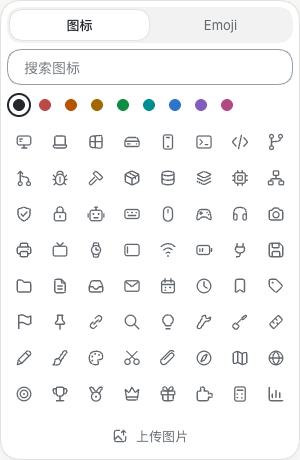
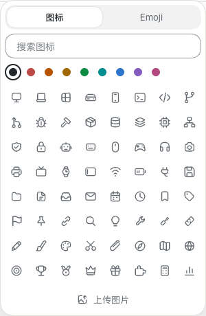
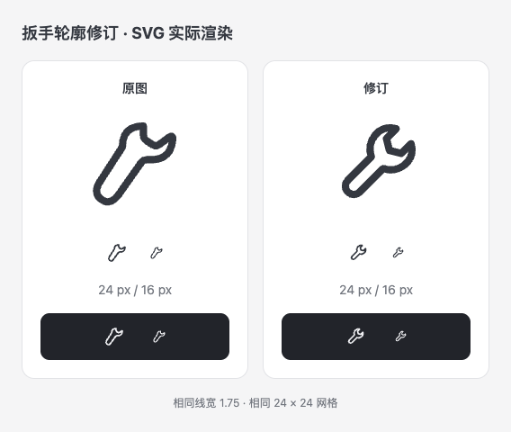
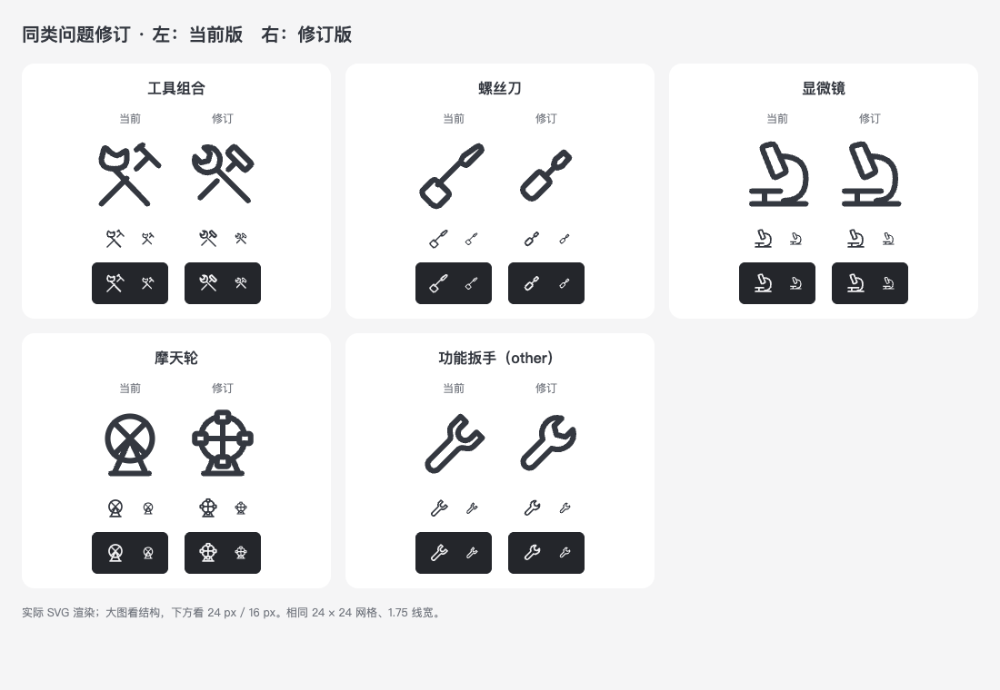

# Icon family alignment

The picker below comes from production site builds with the same demo station and viewport: base `3bb064a7` on the left, the icon update on the right. The functional and station icons now share silhouettes, with the 24-unit grid, 1.75 strokes and round ends. The 奏 and 令 marks and number icons are unchanged.

| Before | After |
| --- | --- |
|  |  |

The update also refines paw, music, snow, hotdog, ferris-wheel, robot, keyboard, file-audio, file-pdf and wrench; aligns 18 station glyphs with functional icons; and reuses library icons or the shared progress ring in eight page-specific uses. Native station glyphs are generated from the same SVG source as the web.

The wrench refinement keeps the two jaw faces parallel and aligns the open head and handle on one diagonal axis. The comparison renders the actual SVGs at enlarged, 24 px and 16 px sizes, on light and dark backgrounds.

## Shape follow-up

A second visual pass covered all 314 station glyphs and 132 functional icons at enlarged and 16 px sizes, then checked the findings at 24/16 px on light and dark backgrounds. The protected marks and their numbers were excluded from edits.

| Asset | Finding | Correction |
| --- | --- | --- |
| station-icons/tools | Uneven wrench jaws and crowded tool heads | Parallel jaw faces and separated heads; the crossing handles retain a clear overlap gap |
| station-icons/screwdriver | Blade, shaft and handle follow different axes | All three parts share one diagonal axis |
| station-icons/microscope | The optical axis falls beyond the stage edge | Shift the tube and extend the stage under its axis |
| station-icons/ferris-wheel | Removing the cabins made the earlier refinement resemble a fan | Restore four outlined cabins, with clear gaps and the stand below the wheel |
| icons/other | The functional wrench retains a separate silhouette | Use the same SVG as station-icons/wrench |

