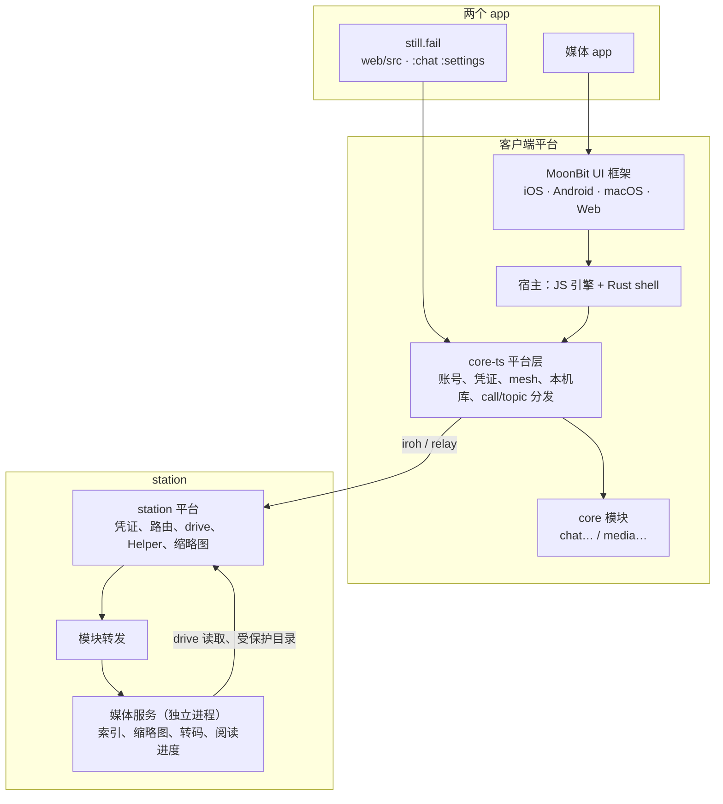

# 媒体 app：和 still.fail 共用平台的拆分方案（草案）

2026-10-19。新 app 管三样东西：照片（自己拍的，手机自动备份）、影视库（扫目录、刮海报、串流）、书架（收集的小说，类似微信读书）。内容都在自己的 station 上，各端连回去看。

## 目标与不做的事

- 新 app 独立：自己的名字、安装包、web 域名。still.fail 的包里没有一行媒体代码，媒体 app 的包里也没有聊天代码。
- 两个 app 共用一个平台：同一个账号、同一个 workspace、同一台 station，凭证和连接方式不变。
- 新 app 的界面全部用 MoonBit UI 框架做，iOS、Android、macOS、Web 一起出；core 用 still.fail 的 core-ts。
- 不做：单独的账号体系；把聊天之外的 still.fail 功能搬进新 app。

## 总体结构



## 一、client core：平台和业务分开

现状：`client/core-ts`（约 4 万行）本身已是通用平台，Comma 也嵌入过它；但组装是写死的。`Core.make`（core.ts:139-231）静态 import 并 install 所有模块，`Call` 是封闭 union，`parseCall` 是一大段 switch（calls.ts:238），`PARAMS` / `stationOp`（ops.ts）、topic 列表（station/topics.ts）、`HELD` 和本机库 schema（data.ts、db/schema.ts）、shapes codegen 都是一张大表。所以哪个 app 嵌入它，都会带上全部聊天代码。

已有两个插拔点可以沿用：`handlers` 表（execute.ts:19，模块 `install()` 往里填）和 `Router.owners`（routing.ts:14）。

做法：

- 定义 `CoreModule`，一个模块自带它的全部东西：

  ```ts
  type CoreModule = {
    name: string;
    calls?: Record<string, { parse; run; station?; cancellable? }>;
    owners?: (inner) => Owner[];           // 它负责的 topic
    ops?: { params; request };             // 对 station 的操作
    tables?: Migration[];                  // 本机库里它自己的表
    held?: string[];
    sync?: StationSyncHooks;               // 连上 station 后要同步的东西
  };
  ```

- `Core.make(host, { modules })`；web 的 `startWeb`、Node 的 `start`、安卓的 Hermes 入口都接 `modules`。平台层只剩账号、凭证、mesh、station 链路、本机库框架、call/topic 分发。
- `parseCall` 先查模块表，查不到再走旧 switch：可以一块块搬，不用一次改完。shapes 和 operations 的 codegen 按模块出文件。
- 搬的顺序：先搬 **drive**（两边都用，边界最清楚）当试点；再搬媒体 app 用得到的 vault、memberships；聊天那一大块（entries、history、decisions、jobs、adb…）在 still.fail 侧慢慢搬，不挡媒体 app。
- 本机库里平台的表（account_doc、workspace、station）留在平台层；chat、session、thread、entry、job、outbox 等跟聊天模块走。
- **web 必须分 origin**：Web Lock、IndexedDB、OPFS 都叫 `stillfail-core`（worker.ts:30、hosts/web.ts:22、worker.ts:160），同 origin 下两个 app 的 worker 会互相 retire，轮换的 refresh token 还会被当成被盗。媒体 web app 用自己的域名，cloud 的回调白名单（auth.ts:49/56）加上它和桌面的新 scheme。

## 二、UI：MoonBit UI 框架（2026-10-19 用户定）

新 app 的客户端界面全部用 MoonBit UI 框架来画（另一个 chat 在做：跨 macOS、iOS、Android、Web，GPU 自绘，文字走系统引擎）。书架、阅读器、相册网格、播放器都由那边在框架里做，所以新 app 不做 React 页面，也不做 Compose 界面。iOS 在框架下是顺带的，和其他三端一起出。

这边只负责到 core 为止，交给框架的是两样：

1. **嵌入**：新 app 用和安卓一样的宿主路线：JS 引擎（Hermes / JavaScriptCore / Web Worker）跑 core-ts 的 bundle，IO 走 Rust shell 的 C ABI（`client/shell`、`hosts/bridge.ts`）。
   - `Core.create(host, options)` 的 `options` 里加 `modules`；`startBridged(native, cloudOrigin, beta, os, onFatal, extra?)` 末尾加一个可选的 `{ modules, brand }`。都是追加的，现有调用不用改。
   - 原生那一侧不变：`__stillfail.start/connect/receive/receiveBytes/disconnect/complete`、`__native.*`、JSON 协议（call、subscribe、value/delta）都照旧。
   - 新 app 打自己的 bundle：新入口 `hosts/hermes-media.ts` 把媒体模块传进去，`scripts/hermes-bundle.ts` 加一个参数选入口。数据目录和 Web 的 origin 各用各的。
2. **媒体模块的 call 和 topic**：见下面「媒体模块的 core 接口」。

still.fail 自己的 web（`web/`、`@stillfail/ui`）和安卓（Compose）不受影响，照旧。前面提到的 `@stillfail/client-web` 和安卓的 `:design` / `:platform` 拆分不再是新 app 的前提，只当作 still.fail 自己的整理，以后再说。

## 媒体模块的 core 接口（草案，第 1 期定稿进仓库 docs/media.md）

全部按 core 现有的协议：topic 从本机库读、缓存优先，由 sync 在后台跟 station 保持一致；call 是一次操作。每条都带 `station`（媒体在哪台 station 上）。

**书架**

| 名字 | 类型 | 参数 → 内容 |
|---|---|---|
| `media.shelf` | topic（keyed） | `{station}` → 书列表：`{id, title, author, cover?: thumbhash, format, chapters, place?: Place, added, read?}` |
| `media.book` | topic | `{station, book}` → 目录：`{id, title, toc: [{index, title, level, chars}]}`，`chars` 是这一章的 UTF-16 长度 |
| `media.chapter` | call | `{station, book, index}` → 这一章的结构化正文：`{chars, blocks}`。`chars` 是整章的 UTF-16 长度，进度条不用先排版；`blocks` 是 `{t:"p", text}`（无样式段落的简写）、`{t:"p", runs:[{text, b?, i?, href?, ruby?}]}`、`{t:"h", level, text}`、`{t:"img", ref, w, h}`、`{t:"hr"}`。图片用 `media.image` 取。读过的章节缓存在本机，离线也能读 |
| `media.place` | topic | `{station, book}` → 阅读位置 `Place = {chapter, offset, at}`，`offset` 是章内偏移，单位是 UTF-16 码元（JS 字符串下标，和各端输入法的下标一致） |
| `media.place.set` | call | `{station, book, place}`，各端同步，以 `at` 最新的为准 |
| `media.notes` | topic（keyed） | `{station, book}` → 划线和笔记：`{id, chapter, start, end, text, note?, color, at}` |
| `media.note.put` / `media.note.remove` | call | 增改、删除一条 |
| `media.import` | call | `{station, path}`（drive 上的文件或目录）→ 导入的书 id 列表 |

分页由框架做：core 只给结构化正文和字符偏移，不给页码。每台设备的字号和屏幕都不一样，所以位置一律按 UTF-16 偏移存，页由排版现算。

**照片和视频**

| 名字 | 类型 | 参数 → 内容 |
|---|---|---|
| `media.timeline` | topic（keyed，分页） | `{station, album?, window: {around?: day, before: N, after: N}}`（以某一天为中心前后各 N 天，不给 `around` 就从最新的开始）→ `{days: [{day, items: [{id, kind: "photo" \| "video", taken, w, h, thumbhash, duration?}]}], more: {before, after}}`；跳到某天、滚到边界都是换 window 重新订阅一次，已有的条目不会重发 |
| `media.albums` | topic（keyed） | `{station}` → 相册：`{id, title, cover, count}` |
| `media.thumbs` | call，回字节 | `{station, ids, size: "grid" \| "large"}` → 多张图拼成一段字节，JSON 里是每张的 `{id, offset, length, w, h}`；网格一屏几十张走这个 |
| `media.thumb` | call，回字节 | `{station, id, size}` → 单张（WebP/JPEG）和它的 `w, h` |
| `media.item` | call | `{station, id}` → 详情：EXIF、地点、原文件路径（原图和视频用已有的 `drive.read` 或流地址取） |
| `media.image` | call，回字节 | `{station, book, ref}` → 书里的插图 |

影视（第 3 期）以后再加：`media.library`、`media.title`、`media.play`（给流地址：能直接解码的用原文件，不能的给 HLS）。

## 三、station：媒体服务是旁边的独立进程

现状：station 是有意手工接线的（main.ts 开头写明 nothing registers itself），没有模块机制。加一个子系统要改约十处：services、路由表、overview、MCP 工具、只读白名单……

两种做法：

| | 进程内模块 | 独立进程（推荐） |
|---|---|---|
| still.fail station 的体积 | 带上媒体代码，或要分两个 station 构建 | 只多一个通用的转发层 |
| 重活（扫库、缩略图、ffmpeg 转码） | 和聊天抢主线程，要自己挪 worker | 天然隔离，崩了不影响 station |
| 发版 | 跟 station 一起 | 各发各的 |
| 受保护目录（文稿、下载、外接盘） | 直接用 Helper | 经 station 的本机接口读 |
| 实现量 | 小 | 中：多一个本机接口和进程管理 |

推荐独立进程，同一台机器只有一个 station，它只做三件通用的事：

1. **转发**：`/admin/api/m/<模块>/…` 原样转给模块的本机 socket，带上已验证的成员身份（账号、角色、workspace）。凭证、吊销、工作区锁都还是 station 管，模块只看身份，不碰 iroh。
2. **本机接口**：模块经 socket 调 station 的 drive（list、stat、分段读、watch），这样 Helper 保护的目录和「station 自己的数据不可达」这些规则只有一份。缩略图和 ThumbHash 的原生实现（mesh.node 里的 thumbs.rs）也经这里给出，或者模块直接加载同一份原生件。
3. **生命周期**：config.json 的 `modules` 列出启用的模块，station 负责下载（签名校验同 station 自更新）、启动、重启、停止。overview 里带上 `modules`，客户端据此显示入口。

这一层同时去掉几处现有的耦合：只读成员的写白名单改为由模块声明（viewer 也要能存自己的阅读进度和笔记）；模块的数据按 workspace 隔离由转发层给的身份决定；缩略图不再只能经会话路由取。

## 四、媒体服务本身

- **存储**：自己的 `media.db`（SQLite），不碰 `stillfail.db` 的 `user_version 12`。表：媒体条目（路径、类型、时间、尺寸、时长、EXIF/GPS）、相册、人物（以后）、影视条目和刮来的元数据、书、阅读进度、划线和笔记（按成员存）。
- **索引**：按 drive 的 pinned 目录递归扫描（drive 现在只做单层列目录），用 watch 增量更新；EXIF 和视频时长用 exiftool/ffprobe 读取，或者原生实现。
- **缩略图**：网格用小图 + ThumbHash，缓存在 `<data>/modules/media/cache`；HEIC 走 sips（macOS）或 ffmpeg。
- **视频**：浏览器能直接解码的就沿用现有的分段读取和客户端 Range 模拟（web 的 service worker、桌面的 `stillfail-drive://`、安卓 media3），这些已经能拖动；mkv、HEVC、avi 等放不了的，由 ffmpeg 转成 HLS/fMP4 分段，随看随转。转码队列由媒体服务自己管：现有 jobs 绑在会话上，不适合用来转码。
- **书架**：导入 epub/txt/mobi，解析目录和分章，阅读进度、划线、笔记存在 station 上，多端同步（现在的 `drivePlace` 只存在本机）。阅读器由 MoonBit 框架来做（中文排版、分页、划线）。
- **照片备份**：手机（安卓、iOS）后台上传，沿用 drive 现有的可续传分段上传，按日期落到指定目录。
- **AI**：调 still.fail 的 agent 来做（按人物或地点整理相册、章节摘要、人物关系、问书）。媒体 app 发起一个 still.fail chat 去跑，结果写回 media.db；两个 app 之间可以互相跳转。

## 五、CI

workflow 没有 `paths:`，是靠 `pipeline.yml` 的 plan 步骤和 `check.sh` 的正则按改动路径决定跑什么。

- plan 加 `media` 一项；check.sh 加对应的 part。
- 共享路径（`client/core-ts` 平台层、`client/shell`、station 平台）两边都跑；只属于 still.fail 的（`web/`、安卓 `:chat :settings`）不触发媒体那边，媒体模块和媒体服务也不触发 still.fail 的 web 和安卓构建。
- `apps/android/carries.sh` 现在按 `^client/` 触发，要收窄到平台层。

## 分期

| 期 | 内容 | 能看到什么 | 估计 |
|---|---|---|---|
| 1 | core 的 `CoreModule` 机制，drive 搬成第一个模块；`startBridged` 加 `modules`、新 app 的 bundle；station 的模块转发、本机接口、生命周期；媒体服务骨架和书架的 call/topic | 框架做的书架里导入一本 epub，换台设备接着读 | 2–3 周 |
| 2 | 照片：索引、缩略图、时间线 topic；手机自动备份的上传接口 | 手机拍的照片自动出现在各端时间线 | 2–3 周 |
| 3 | 影视：刮削、转码串流、续播、字幕 | 家里的 mkv 在手机上外网也能拖着看 | 3 周 |
| 4 | AI 整理和 still.fail 互通；聊天模块逐步搬进 `CoreModule` | 一键「按人物整理」 | 持续 |

每期做完、给出证据，用户认可之后再往下。拆分平台的改动对 still.fail 来说是重构，按修复类的规矩走 CI；媒体 app 是新功能，先给你看再合。

## 待定

1. **名字**。候选：
   - **still.life**：静物，也是「生活」；照片、影像和书放在一起，和 still.fail 是一家（域名还没查）。
   - **still.frame**：定格，偏照片和影视，书架不太贴。
   - **藏（Keep）**：收藏的意思，中文好记，和 still.fail 的关联弱一些。
2. **ffmpeg**：随媒体服务一起分发（LGPL 版每个平台约几十 MB，转码开箱就能用），还是用户自己装（现在海报就是看 PATH 里有没有）。倾向随包分发。
3. **影视元数据**：用 TMDB（免费，但要申请 API key，还有署名要求），或者先只用文件名和本地 nfo。
4. **web 域名**：比如 `life.still.fail`，或者新名字自己的域名。
