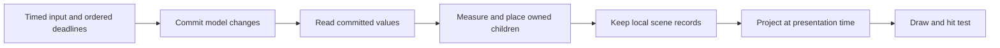

# A runtime derived from the requirements

Status: independent experiment against `351cef2857f2b281a25728363e9416fbc6b469bb`.
No application uses this runtime. The design below distinguishes what the slice
implements from the larger contracts a replacement would have to prove.

## What must be independent of drawing

The observable result at time t is a function of the initial model, external
inputs with their timestamps and order, environmental inputs, and t. The number
of frames drawn before t is not an input to that function.

This cannot mean that every render allocation has identical history. A lazy
list drawn at two distant moments may allocate two small windows. Drawing all
the intervening moments must allocate more windows. Requiring identical mount
side effects would force the skipped run to visit every intermediate row, or
force the dense run to avoid mounting content it must draw.

Therefore two lifetimes must have different owners:

- Model owners hold drafts, selection, navigation, tasks, deadlines and the
  causes of transitions. Timed inputs create, change and release them.
- Render resources hold measured paragraphs, layout nodes, draw records and
  atlas references. Queries may create and evict them without observable model
  changes. Eviction may release a GPU allocation; it may not send a message,
  clear a draft, reset an animation or cancel an unrelated application task.

The unmodified runtime permits arbitrary row-construction and cleanup callbacks.
`src/control/lifetime_test.mbt` demonstrates the distinction: for the same
uniform-height scroll, sparse frames create/release 6/3 rows and dense frames
28/25, while both end on rows 25–27 at offset 1000. This proves an API/contract
gap, not a claim that every application row currently performs harmful work.

With alternating 40/80 row heights and an estimate of 40, the same control also
finds a visible discrepancy: at time 1000 and offset 1000, sparse frames show
rows 24–25, while dense frames show rows 17–18. Earlier optional measurements
have become an input to the meaning of the scroll, not merely a cache.

## The forward computation

| Operation | May change | May read | Must not do |
| --- | --- | --- | --- |
| Commit an input | Model, owners, trajectories, commands | Committed model, geometry queried at the event's moment | Take a new wall-clock reading midway, enter a second commit recursively |
| Evaluate a value | Its internal dependency/cache records | Committed cells | Write model cells or issue application commands |
| Measure and place | Owned render children and their cache | Captured content, constraints, resource metrics, explicit layout moment | Publish geometry back as model state |
| Compose and project | Transform/damage caches | Scene, trajectories, explicit presentation moment | Advance model lifetime or change layout's time |
| Execute an external command | Host resource or service | The committed command | Complete by mutating the tree; completion is another timed input |

State writes need a transaction belonging to that store. A transaction closes
before observers are notified. Retaining it in a closure grants no future write
permission. Queries cannot start commits, and their model setter rejects writes.
The slice implements this in `state.mbt`, using the existing signal dependency
tracker; its watches only become stale. They never compute UI while a write is
being delivered. Layout queries observe the cells they actually read, replacing
the first prototype's manually maintained `layout_due` flags.

These capabilities protect the managed model, not arbitrary MoonBit references
or FFI. A production component API must keep host commands and model mutation
behind this boundary, with checks on pure component/layout callbacks. Giving a
callback a read-only parameter alone does not make an impure language pure.

## Time is an argument and a cause

There is one timeline. An input's timestamp, a logical deadline, a layout's
moment and a display's prediction are uses of that timeline, not mutable clocks
that observers can advance.

A trajectory stores initial value, velocity, target, cause timestamp and curve.
Sampling does not change it. Interrupting it samples the initial value and
velocity at the interrupting event's timestamp. A zero-duration transition is
already at its target at that timestamp. An unfinished transition is exactly at
its initial condition at the start; recomputing a spring's zero-time formula
can otherwise round the velocity and break that identity.

Deadlines are ordered by timestamp and stable sequence. They execute with their
declared cause timestamp even if the host wakes late. Projection beyond a
deadline cannot execute it early. Due model work is drained iteratively before
the input or frame observes the model. A zero-time causal cycle is an error
with its chain, not a reason to take another frame or deepen the call stack.

The slice implements interrupted trajectories and one page owner's exit
deadline, including immediate completion and late delivery tagged with the
deadline's cause. It does not implement a general deadline heap or owner tree yet.

## Geometry has an owner

Sibling geometry belongs to the nearest parent that needs both sizes. In a
chat, that parent measures the composer and allocates the remaining constraint
to the list. No child publishes a measured height that re-enters composition.

A lazy container may create and measure its own render children while filling
its allocated viewport. This is a restricted operation of that container, not
general application composition during layout. A popover's anchor is a geometric
dependency on an already placed node; constraints must make that dependency
acyclic, rather than turn the rectangle into a general mutable state signal.

A size transition is sampled at the explicit layout moment. A compositor-only
transition may be sampled ahead. Hit testing projects at the input's moment and
uses the same scene transforms and clips. It never trusts the last painted frame
to describe an input that arrived later.

## What local work can actually promise

The model stores keyed values and versions. A row update invalidates a query
only if that query read that row. A layout cache key also includes its actual
constraints and resource inputs. Font, scale and shaping availability cannot be
unrecorded global variables if the cache is expected to be correct.

Ordinary work is proportional to visible content, changed content and the
dependency path between them. Whole snapshots are ingested once. A transform
does not reshape text; a color does not lay out a list. The same distinction must
continue through retained scene records to host uploads and GPU damage.

The actual Android input counterexample makes the last boundary explicit:
rebuilding the right draw records is not enough if the host is told that no
pixels changed. A committed scene change must carry its previous and resulting
paint extent into the same presentation packet as the updated records. The
host adapter must not independently infer whether those records need painting.
The old extent clears removed or shrinking content, and the resulting extent
covers new content. Ancestor traversal needed to compose an affected child does
not itself mean the entire ancestor is damaged. Paint dependencies, scheduled
paint changes and resource completion must all enter this protocol; layout is
only one source of scene changes.

Presentation tests must therefore check both the content and the pixels the
host is instructed to replace. A model assertion, a paint callback having run,
or equality of full-render screenshots cannot prove partial presentation is
correct. This protocol is a requirement discovered in the application adapter;
the standalone kernel slice has not implemented a GPU presentation packet.

There is an information limit for unknown variable heights: finding the row at
an arbitrary absolute pixel distance requires knowing the intervening heights,
or deliberately defining an estimate-based operation. No cache design makes
that information free. Jumping to a known key is different: its key and offset
can be the anchor without measuring the entire preceding history.

For continuous motion, geometry discovered by optional frames must not silently
change its logical anchor. The reference resolver samples a forward distance
from an explicit row key, measuring unknown crossed rows, then filling the
viewport. Its alternating-height example reaches rows 17–18 whether earlier
frames ran or not. It also supports jumping directly to a key and filling the
end window. This is position resolution, not a complete scrolling interaction:
gesture velocity, overscroll, insertion, removal and anchor preservation across
resource updates still require a specified event protocol.

The indexed resolver assigns dependencies to intervals. The source collection's
single-item write increments the versions on that item's path. Layout reads
only the intervals it actually skips and the rows it uses; checking whether an
unused cached interval is valid creates no dependency. Thus a change before the
anchor does not dirty this query, while a changed crossed height does. No text
measurement or layout runs while the versions are written. This source is a
fixed-length collection of stable slots; insertion and removal are not supported.

An uncached crossing costs O(crossed + visible + log N); a cached crossing uses
O(log N + visible) work, with changed paths recomputed when read. Initialization
and source metadata are O(N); cached geometry grows with the visited content.
These are algorithmic bounds, not a phone frame-budget measurement.

Even floating-point addition order can turn a cache into a semantic input.
For example, rounding a 0.7 + 0.1 interval before comparing it with a requested
distance can disagree with subtracting the two rows separately. The index uses
exact binary sums of the supplied finite Double heights and rounds only the
final coordinate. The reference `Extent` uses a normalized integer and binary
exponent; BigInt makes the contract direct to audit. Its memory and allocation
cost is not yet justified for the production runtime. Neither an arbitrary
epsilon nor pixel quantization is used to hide a boundary discrepancy.

## Comparison and integration

The architectural alternative is a small model runtime plus read-only
incremental queries and a retained scene. It can reuse signal dependency
tracking, flex calculations, text shaping, curve solvers, drawing and existing
leaf renderers. Replacing those algorithms is not required by the causal model.

Adoption needs evidence in this order:

1. Counterexamples must be rejected by the protocol or give the specified result:
   host time changing during layout, lazy mount side effects, variable heights,
   interruptions, late completion after owner release and input between frames.
2. Existing leaf components must measure and render from an explicit allocation
   without feeding geometry back to the parent. Full editor input/IME behavior
   and font changes must be checked, not just a synthetic intrinsic height.
3. A real chat must consume the same input/text-metric tape and have equivalent
   functional and visual output, with 60 Hz, 120 Hz and sparse frames. Internal
   allocation histories may differ; semantic histories may not.
4. The same classic Wasm development target must meet the actual Android frame
   budget with CPU, GPU, allocations and memory observed. Desktop throughput
   and green contract tests are not that evidence.

The experiment is grounds for evaluating this boundary more deeply. It is not
yet grounds for replacing the running application or claiming the phone is fast.
